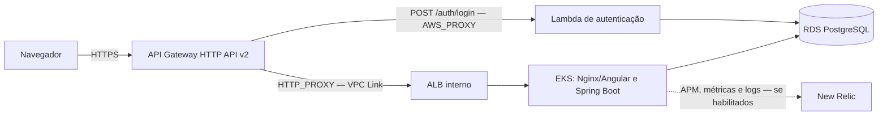

# Infraestrutura do AutoFlow

Este repositório declara em Terraform a rede e o EKS do AutoFlow, a API Gateway HTTP API v2 e a integração New Relic. O
gateway encaminha o login à Lambda e o tráfego da aplicação a um ALB interno no EKS.

## Responsabilidade e arquitetura

| Root Terraform | Responsabilidade | Dependências principais |
|---|---|---|
| `infra/` | VPC, subnets, Security Groups, EKS e node group | Bootstrap do bucket de State |
| `infra/api-gateway/` | HTTP API, rotas, Lambda integration, VPC Link, ALB e alarmes CloudWatch | VPC/EKS e Lambda |
| `infra/newrelic/` | Integração Kubernetes, dashboards, alertas NRQL e Synthetic | EKS, workloads e Secrets prontos |

Os outros repositórios provisionam o RDS (`autoflow-db`), a função (`autoflow-lambda`) e os workloads Kubernetes
(`autoflow`). O contrato central está no [guia OpenAPI](https://github.com/autoflow-fiap/autoflow/blob/develop/docs/openapi/README.md)
e na [coleção Postman de autenticação](https://github.com/autoflow-fiap/autoflow/blob/develop/backend/postman/autoflow-serverless-auth.postman_collection.json);
o modelo relacional está no [diagrama ER](https://github.com/autoflow-fiap/autoflow-db/blob/develop/docs/diagrama-er.md).



Os diagramas C4, sequências de autenticação e implantação estão em [arquitetura e fluxos](docs/api-gateway/arquitetura.md).
As decisões e procedimentos estão no [ADR-001](docs/api-gateway/adr-001-api-gateway.md), [RFC](docs/api-gateway/rfc-api-gateway.md)
e [runbooks](docs/api-gateway/runbook.md).

## CI/CD e ambientes

- `develop` seleciona `homolog`; `main` seleciona `production`.
- `ci.yml` valida os roots, testes e guardrails em Pull Requests para `develop`/`main` e pushes para essas branches e
  `feature/**`. A CI não usa credenciais AWS nem executa Plan/Apply.
- Os workflows `Pipeline`, `Migração HTTP API` e `New Relic Pipeline` também recebem `push` em `develop`/`main`.
- O gate valida a CI do mesmo repositório, branch e SHA. As Repository Variables `AUTO_CD_ENABLED_HOMOLOG` e
  `AUTO_CD_ENABLED_PRODUCTION` habilitam o caminho automático por branch (`develop` e `main`, respectivamente), que
  executa Plan, não Apply. Somente o valor literal `true` habilita o Plan.
- Apply requer `workflow_dispatch` com `apply=true` e `TERRAFORM_APPLY_APPROVAL_CONFIGURED=true`; os jobs usam o
  Environment selecionado. Configure Required reviewers e restrições de branch nos Environments; `main` exige proteção
  de branch.
- O bootstrap do bucket é um dispatch isolado documentado em [state-bucket-bootstrap.md](docs/state-bucket-bootstrap.md).
- `pr-automatico.yaml` solicita Pull Request de `main` para `develop` em pushes para `main`.
- Configure proteção de branch em `develop` e `main` para exigir Pull Request e checks de CI.

CI e Terraform Plan validam código e mudanças propostas; somente Apply provisiona ou atualiza recursos AWS. Consulte
[início automático do CD](docs/ci-cd-automatico.md) e o [catálogo de Variables e Secrets](docs/variables-and-secrets.md).

## Ordem de provisionamento

Para cada ambiente, respeite as dependências nesta ordem:

1. `autoflow-infra` — VPC/EKS.
2. `autoflow-db` — RDS PostgreSQL.
3. `autoflow-lambda` — autenticação.
4. `autoflow-infra` — API Gateway.
5. `autoflow` — aplicação Kubernetes.
6. `autoflow-infra` — New Relic.

O provisionamento é separado por repositório e não é orquestrado automaticamente. Use o [runbook de primeiro provisionamento](docs/eks-primeiro-provisionamento.md)
e não inicialize State vazio sobre recursos existentes.

Para operação, consulte o [bootstrap do bucket](docs/state-bucket-bootstrap.md), o [runbook de manutenção dos nós EKS](docs/eks-node-recovery.md)
e a [configuração dos runners GitHub-hosted](docs/github-runner.md).

## Terraform State e observabilidade

Os seis roots mantêm States S3 separados por root e Environment: VPC/EKS, RDS, Lambda, API Gateway, aplicação e New Relic.
As keys são fornecidas pelos GitHub Environments e devem permanecer distintas; dependências e validações estão na [tabela de ownership](docs/api-gateway/arquitetura.md#states-e-ownership).

A aplicação configura o agente APM Java, logs JSON correlacionados e eventos de negócio. `infra/newrelic/` provisiona,
quando habilitado por Environment, monitoramento Kubernetes/Fluent Bit, dashboards e condições de alerta para CPU/memória,
latência, disponibilidade e eventos de OS. Synthetic requer URL e locations. O root de API Gateway configura logs e
alarmes CloudWatch; seus destinos SNS são opcionais. Consulte [`infra/newrelic/README.md`](infra/newrelic/README.md).

## Validar localmente

Valide o root VPC/EKS sem backend remoto e sem acesso à AWS:

```bash
terraform -chdir=infra init -backend=false -input=false
terraform -chdir=infra validate
```

Os outros roots têm seus próprios comandos e pré-requisitos documentados nos respectivos READMEs. O Plan apresenta as
mudanças propostas; Apply é a operação que provisiona ou atualiza recursos e deve ser executado pelos gates do Environment.
