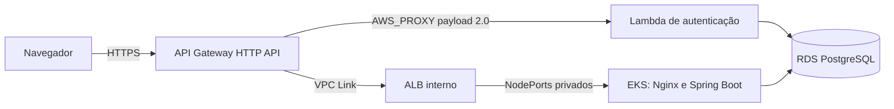

# Infraestrutura do AutoFlow

Este repositório declara a infraestrutura AWS do AutoFlow com Terraform. A arquitetura final é **Amazon API Gateway HTTP API, Lambda, VPC Link, ALB interno, EKS e RDS PostgreSQL**. Não há instalação ou roteamento Kong na configuração operacional.

## Documentação da arquitetura

Leia na ordem: [arquitetura e diagramas C4](docs/api-gateway/arquitetura.md), [ADR-001](docs/api-gateway/adr-001-api-gateway.md), [RFC técnica](docs/api-gateway/rfc-api-gateway.md), [runbook operacional](docs/api-gateway/runbook.md). O [README do root Terraform](infra/api-gateway/README.md) contém validações locais.

O contrato central da aplicação está no [OpenAPI e guia da API](https://github.com/autoflow-fiap/autoflow/blob/develop/docs/openapi/README.md); a [coleção Postman de autenticação CPF/JWT](https://github.com/autoflow-fiap/autoflow/blob/develop/backend/postman/autoflow-serverless-auth.postman_collection.json) também é mantida no repositório da aplicação.

Os ambientes usam os mesmos roots Terraform: `develop` seleciona `homolog` e `main` seleciona `production`. Consulte o [catálogo de variables e secrets](docs/variables-and-secrets.md) para configurar, em cada GitHub Environment, a conta esperada, credenciais temporárias, bucket e keys do Terraform State. Use keys separadas por ambiente e por root. Os nomes EKS são derivados do projeto; nenhum ID de conta ou credencial é versionado.

Para investigar nós EC2 que não registram no Kubernetes, consulte o [runbook de diagnóstico e recuperação EKS](docs/eks-node-recovery.md). O procedimento é somente leitura até a seção explícita de recuperação manual; não há reboot automatizado.

O root `infra/` e o workflow `Pipeline` gerenciam somente VPC/EKS. New Relic tem state e workflow independentes em [`infra/newrelic/`](infra/newrelic/README.md), sem duplicar recursos AWS de plataforma.

Para criar o ambiente pela primeira vez, siga a [ordem de provisionamento](docs/api-gateway/runbook.md) e o [runbook de primeiro provisionamento EKS](docs/eks-primeiro-provisionamento.md). API Gateway e New Relic iniciam por `workflow_dispatch` explícito depois que suas dependências estiverem prontas; após o state de cada root existir, mudanças correspondentes em `main` seguem CD automático. Para New Relic, sincronize antes a License Key pela pipeline da aplicação e confirme que os workloads estão saudáveis. Para objetos New Relic preexistentes, siga o [runbook de migração de state](docs/newrelic-state-migration.md), sem executar migração em deploy normal.

A sequência de reconstrução e os limites dos procedimentos estão documentados no [runbook de primeiro provisionamento EKS](docs/eks-primeiro-provisionamento.md) e no [runbook do API Gateway](docs/api-gateway/runbook.md).

Para diagnóstico dos nós EKS, consulte o [runbook](docs/eks-node-recovery.md). O provisionamento da EC2 runner está descrito em [Runner privado do GitHub Actions](docs/github-runner.md).

## Responsabilidades

- `infra/`: VPC, subnets, Security Groups, EKS e node group.
- `infra/api-gateway/`: HTTP API, rotas, integração nativa com Lambda, VPC Link, ALB interno, Target Groups e observabilidade.
- `autoflow`: Deployments, Services internos e NodePorts privados consumidos pelo ALB.
- `autoflow-lambda`: função de autenticação e execução em rede privada.
- `autoflow-db`: RDS PostgreSQL e controles de rede.

## Fluxo de requisições



O navegador usa a mesma origem HTTPS para frontend e API. O API Gateway invoca a Lambda diretamente; as integrações de negócio e frontend usam VPC Link e ALB interno. A Function URL antiga foi removida; a invocação da Lambda ocorre pela permissão restrita ao API Gateway.

## Ordem de implantação

Para cada ambiente, execute a sequência de dependências: (1) VPC/EKS e rede; (2) RDS e conectividade privada; (3) Lambda; (4) dispatch inicial de API Gateway, VPC Link e ALB interno; (5) aplicação no EKS; (6) New Relic após License Key e workloads saudáveis; (7) smoke tests ponta a ponta. Produção usa os recursos `autoflow-production`; homologação mantém `autoflow`. O procedimento está no [runbook](docs/api-gateway/runbook.md).

## States e pipelines

Os componentes usam States S3 separados por ambiente e root: infraestrutura EKS, New Relic, aplicação, RDS, Lambda e API Gateway. As keys são fornecidas por GitHub Environment, começam por `homolog/` ou `production/`, têm sufixos definidos externamente e nunca podem ser compartilhadas. Os roots de um Environment usam a mesma conta, bucket e região configurados para aquele Environment; consumidores recebem exatamente a key do produtor. Antes da inicialização, os workflows validam a identidade esperada e o proprietário do bucket. Não inicialize State vazio sobre recursos existentes e não edite arquivos de State manualmente.

### Validação integrada dos seis States

Execute os testes locais da política integrada, sem acesso à AWS:

```bash
python -m unittest discover -s scripts -p 'test_terraform_state_contract.py' -v
python -m unittest discover -s scripts -p 'test_terraform_deployment_fingerprint.py' -v
```

Para conferir a configuração efetiva antes de qualquer operação Terraform, prepare fora do checkout um JSON com os roots `vpc_eks`, `rds`, `lambda`, `application`, `api_gateway` e `newrelic` para ambos os Environments. Cada root informa `account_id`, `bucket`, `region` e `key`; roots consumidores também informam em `consumes` as keys recebidas dos produtores. O contrato compara RDS→VPC/EKS, Lambda→VPC/EKS e RDS, aplicação→RDS, API Gateway→VPC/EKS e New Relic→VPC/EKS. Obtenha os valores diretamente das Variables dos GitHub Environments e não registre o arquivo, valores reais, IDs, ARNs ou States no repositório ou nos logs.

```bash
python scripts/terraform_state_contract.py <caminho-externo-para-configuracao.json>
```

O comando exige prefixos por Environment, seis keys exclusivas por bucket, ausência de cruzamento entre homologação e produção, igualdade produtor/consumidor e correspondência de conta, bucket e região. Ele não inicializa backend, consulta objetos S3 ou lê conteúdo de State. Os testes usam apenas valores sintéticos e não definem sufixos autoritativos.

Os backends S3 recebem `expected_bucket_owner`. No Terraform 1.16.5, a configuração do data source embutido `terraform_remote_state` não aceita esse atributo; a validação AWS local mostrou erro de atributo inesperado. Por isso, os workflows verificam previamente cada objeto remoto com `head-object --expected-bucket-owner` usando a mesma conta do Environment, e só depois inicializam Terraform. Essa checagem não lê nem imprime o conteúdo do State.

CI executa em PRs; branches feature não acessam AWS nem executam Plan/Apply. `Pipeline` aplica VPC/EKS após Plan e aprovação do Environment em `develop` e `main` protegida. O primeiro Apply de API Gateway e New Relic é um dispatch explícito posterior à implantação das dependências; uma vez criado o State, pushes correspondentes em `main` seguem CD automático. Apply de produção só prossegue em `main` protegida quando o Environment `production` tem `TERRAFORM_APPLY_APPROVAL_CONFIGURED=true` e Required reviewers efetivamente configurados; a própria proteção do Environment exige aprovação. Exclusões e substituições permanecem bloqueadas por padrão e exigem autorização explícita em dispatch, além dos guards do Plan. O workflow de criação automática de PRs é restrito a pushes em `main`. Consulte a [RFC](docs/api-gateway/rfc-api-gateway.md) e o [runbook](docs/api-gateway/runbook.md). Nenhum workflow instala gateways adicionais.

Use `AWS_PROFILE`, `AWS_REGION`, `AWS_EXPECTED_ACCOUNT_ID` e `TF_VAR_*` localmente. Antes do Plan VPC/EKS, `scripts/verify_eks_iam_roles.py --discover` identifica exatamente uma role de cluster e uma de node group por STS/IAM, validando conta, trust policies, AWS managed policies e a role do cluster existente. O Apply valida as roles gravadas no Plan aprovado, sem as redescobrir. Os guards são somente leitura e não alteram IAM. GitHub Actions Variables contêm conta, região, bucket e keys; credenciais e dados sensíveis permanecem em GitHub Secrets.
