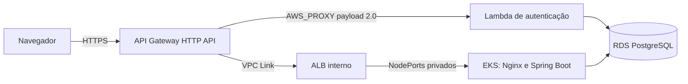

# Infraestrutura do AutoFlow

Este repositório declara a infraestrutura AWS do AutoFlow com Terraform. A arquitetura final é **Amazon API Gateway HTTP API, Lambda, VPC Link, ALB interno, EKS e RDS PostgreSQL**. Não há instalação ou roteamento Kong na configuração operacional.

## Documentação da arquitetura

Leia na ordem: [arquitetura e diagramas C4](docs/api-gateway/arquitetura.md), [ADR-001](docs/api-gateway/adr-001-api-gateway.md), [RFC técnica](docs/api-gateway/rfc-api-gateway.md), [runbook operacional](docs/api-gateway/runbook.md) e [checkpoint de evidências e pendências](docs/api-gateway/progresso.md). O [README do root Terraform](infra/api-gateway/README.md) contém validações locais.

Para configurar Actions e inputs Terraform, consulte o [catálogo de variables e secrets](docs/variables-and-secrets.md) e seu [histórico](docs/variables-changelog.md).

## Responsabilidades

- `infra/`: VPC, subnets, Security Groups, EKS e node group.
- `infra/api-gateway/`: HTTP API, rotas, integração nativa com Lambda, VPC Link, ALB interno, Target Groups e observabilidade.
- `autoflow`: Deployments, Services internos e NodePorts privados consumidos pelo ALB.
- `autoflow-lambda`: função de autenticação e execução em rede privada.
- `autoflow-db`: RDS PostgreSQL e controles de rede.

## Fluxo de requisições

O navegador usa a mesma origem HTTPS para frontend e API. O API Gateway invoca a Lambda diretamente; as integrações de negócio e frontend usam VPC Link e ALB interno. A Function URL antiga foi removida; a invocação da Lambda ocorre pela permissão restrita ao API Gateway.

## Ordem de implantação

Implante ou confirme dependências nesta ordem, respeitando os states e owners existentes: (1) VPC/EKS e rede; (2) RDS e conectividade privada; (3) função Lambda e configuração segura; (4) aplicação no EKS (Services e NodePorts esperados pelo ALB); (5) API Gateway, VPC Link e ALB interno; (6) smoke tests ponta a ponta. Esta ordem decorre das dependências declaradas nos Terraform; não representa uma execução comprovada em conta nova. O procedimento detalhado e as condições de reprodução estão no [runbook](docs/api-gateway/runbook.md).

## States e pipelines

Os componentes usam states S3 separados: infraestrutura EKS, aplicação, RDS, Lambda e API Gateway. Confirme conta, região, bucket, key e state autoritativo antes de inicializar cada root. Não inicialize state vazio sobre recursos existentes e não edite arquivos de state manualmente.

CI executa em PRs e pushes para `develop` e `main`. CD somente por `workflow_dispatch` em `develop` e destinado a `homolog`; os workflows incluem Terraform Plan, verificação de estado/conta, gates para destruições e Apply condicionado aos inputs e guards. Todos os componentes precisam de revisão do plano e autorização específica para mudanças destrutivas. O job usa GitHub Environment `homolog`; **não há evidência local de Required reviewers efetivamente configurados**, portanto não se deve afirmar que exista aprovação efetiva do Environment. Também não há evidência de execução do CD pelo GitHub Actions. Consulte a [RFC](docs/api-gateway/rfc-api-gateway.md) e o [runbook](docs/api-gateway/runbook.md). O workflow de plataforma permanece responsável pelo EKS. Nenhum workflow instala gateways adicionais.

Use `AWS_PROFILE`, `AWS_REGION`, `AWS_EXPECTED_ACCOUNT_ID` e `TF_VAR_*` localmente. O guard `scripts/verify_aws_account.py` deve passar antes de operações AWS. GitHub Actions Variables contêm conta, região, bucket, keys e parâmetros não sensíveis; credenciais e dados sensíveis permanecem em GitHub Secrets.

## Estado de homologação

No checkpoint datado de 13/10/2026, a HTTP API estava implantada; VPC Link `AVAILABLE`; ALB interno ativo; Target Groups frontend/backend 2/2 healthy; RDS disponível; 47 migrations Flyway validadas; login válido, emissão de JWT e consulta autenticada ao backend aprovados após o fechamento da Function URL e retirada do Kong. Isso comprova somente a homologação descrita no checkpoint, não execução de CD pelo GitHub Actions nem implantação em outra conta. Não existe infraestrutura de produção documentada como implantada; a segregação futura com segundo EKS/RDS está fora do estado atual.
