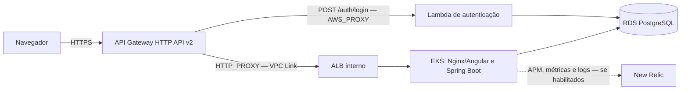

# Infraestrutura do AutoFlow

Este repositório declara em Terraform a plataforma AWS do AutoFlow: rede, EKS, API Gateway HTTP API v2 e integração
New Relic. O gateway encaminha o login à Lambda e o tráfego da aplicação a um ALB interno no EKS. Não há Kong nem
Lambda Function URL na arquitetura ativa.

## Responsabilidade e arquitetura

| Root Terraform | Responsabilidade | Dependências principais |
|---|---|---|
| `infra/` | VPC, subnets, Security Groups, EKS e node group | Bootstrap do bucket de State |
| `infra/api-gateway/` | HTTP API, rotas, Lambda integration, VPC Link, ALB e alarmes CloudWatch | VPC/EKS e Lambda |
| `infra/newrelic/` | Integração Kubernetes, dashboards, alertas NRQL e Synthetic | EKS, workloads e Secrets prontos |

Os outros repositórios provisionam o RDS (`autoflow-db`), a função (`autoflow-lambda`) e os workloads Kubernetes
(`autoflow`). O contrato central está no [guia OpenAPI](https://github.com/autoflow-fiap/autoflow/blob/develop/docs/openapi/README.md)
e na [coleção Postman de autenticação](https://github.com/autoflow-fiap/autoflow/blob/develop/backend/postman/autoflow-serverless-auth.postman_collection.json);
o modelo relacional está no [diagrama ER](https://github.com/autoflow-fiap/autoflow-db/blob/develop/docs/diagrama-er.md).



Os diagramas C4, sequências de autenticação e implantação estão em [arquitetura e fluxos](docs/api-gateway/arquitetura.md).
As decisões e procedimentos estão no [ADR-001](docs/api-gateway/adr-001-api-gateway.md), [RFC](docs/api-gateway/rfc-api-gateway.md)
e [runbooks](docs/api-gateway/runbook.md).

## CI/CD e ambientes

- `develop` seleciona `homolog`; `main` seleciona `production`.
- `ci.yml` valida os roots, testes e guardrails em Pull Requests para `develop`/`main` e pushes para essas branches e
  `feature/**`. A CI não usa credenciais AWS nem executa Plan/Apply.
- Os workflows `Pipeline`, `Migração HTTP API` e `New Relic Pipeline` também recebem `push` em `develop`/`main`.
  O gate espera sucesso da CI do mesmo repositório, branch e SHA. Na leitura somente-leitura do GitHub em 31/10/2026,
  `AUTO_CD_ENABLED` estava ausente nos Environments `homolog` e `production`; portanto, o caminho automático estava
  desabilitado. As últimas execuções automáticas de VPC/EKS, API Gateway e New Relic falharam no gate de origem; nenhum
  Plan desses pushes foi iniciado ([VPC/EKS](https://github.com/autoflow-fiap/autoflow-infra/actions/runs/41160245014),
  [API Gateway](https://github.com/autoflow-fiap/autoflow-infra/actions/runs/41160245051), [New Relic](https://github.com/autoflow-fiap/autoflow-infra/actions/runs/41160245013)).
- Apply não é automático: requer `workflow_dispatch` com `apply=true`, gates do Environment e aprovação aplicável.
  `TERRAFORM_APPLY_APPROVAL_CONFIGURED` estava `false` nos dois Environments, bloqueando Apply. Os Environments tinham
  Required reviewers e políticas de branch (`develop`/`main`); regrasets ativos exigiam Pull Request e checks para ambas
  as branches. A criação/verificação inicial do bucket é um dispatch isolado documentado em [state-bucket-bootstrap.md](docs/state-bucket-bootstrap.md).
- `pr-automatico.yaml` abre Pull Request de `main` para `develop`. A proteção efetiva de branches e a presença de
  Required reviewers foram verificadas somente-leitura no GitHub em 31/10/2026.

A CI/CD está implementada no código; sua ativação depende da configuração externa. Plan e CI não comprovam implantação.
Consulte [início automático do CD](docs/ci-cd-automatico.md) e o [catálogo de Variables e Secrets](docs/variables-and-secrets.md).

## Ordem de provisionamento

Para cada ambiente, respeite as dependências nesta ordem:

1. `autoflow-infra` — VPC/EKS.
2. `autoflow-db` — RDS PostgreSQL.
3. `autoflow-lambda` — autenticação.
4. `autoflow-infra` — API Gateway.
5. `autoflow` — aplicação Kubernetes.
6. `autoflow-infra` — New Relic.

O provisionamento é separado por repositório e não é orquestrado automaticamente. Use o [runbook de primeiro provisionamento](docs/eks-primeiro-provisionamento.md)
e não inicialize State vazio sobre recursos existentes.

Para operação e recuperação, consulte também o [bootstrap do bucket](docs/state-bucket-bootstrap.md), o [diagnóstico de nós EKS](docs/eks-node-recovery.md),
a [migração controlada do State New Relic](docs/newrelic-state-migration.md) e a documentação do [runner privado](docs/github-runner.md).

## Terraform State e observabilidade

Os seis roots mantêm States S3 separados por root e Environment: VPC/EKS, RDS, Lambda, API Gateway, aplicação e New Relic.
As keys são fornecidas pelos GitHub Environments e devem permanecer distintas; dependências e validações estão na [tabela de ownership](docs/api-gateway/arquitetura.md#states-e-ownership).

A aplicação declara o agente APM Java, logs JSON correlacionados e eventos de negócio; `infra/newrelic/` pode provisionar,
conforme Variables do Environment, monitoramento Kubernetes/Fluent Bit, dashboards e condições de alerta para CPU/memória,
latência, disponibilidade e eventos de OS. Synthetic exige URL e locations configuradas. O código não comprova ingestão,
dashboards, alertas ou recursos atualmente ativos. Em 31/10/2026, as flags Kubernetes/recursos New Relic estavam `true`
em `homolog` e ausentes em `production`; isso não comprova Apply ou ingestão. Detalhes em [`infra/newrelic/README.md`](infra/newrelic/README.md).

## Validação local e evidência

Valide o root VPC/EKS sem backend remoto e sem acesso à AWS:

```bash
terraform -chdir=infra init -backend=false -input=false
terraform -chdir=infra validate
```

Os outros roots têm seus próprios comandos e pré-requisitos documentados nos respectivos READMEs. Não execute Plan, Apply
ou Destroy como validação local.

| Estado | Evidência observada em `develop` |
|---|---|
| **Implementado** | Terraform dos roots VPC/EKS, API Gateway e New Relic; CI e gates de CD versionados. |
| **Validado** | A [execução 41163573967](https://github.com/autoflow-fiap/autoflow-infra/actions/runs/41163573967) validou VPC/EKS e Plan com 23 criações, 0 alterações e 0 destruições; publicou artifact criptografado. |
| **Implantado** | Não comprovado. O Apply da execução 41163573967 não foi executado; nenhum endpoint ativo é confirmado. |
