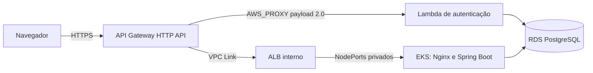

# Infraestrutura do AutoFlow

Este repositório declara a infraestrutura AWS do AutoFlow com Terraform. A arquitetura final é **Amazon API Gateway HTTP API, Lambda, VPC Link, ALB interno, EKS e RDS PostgreSQL**. Não há instalação ou roteamento Kong na configuração operacional.

## Documentação da arquitetura

Leia na ordem: [arquitetura e diagramas C4](docs/api-gateway/arquitetura.md), [ADR-001](docs/api-gateway/adr-001-api-gateway.md), [RFC técnica](docs/api-gateway/rfc-api-gateway.md), [runbook operacional](docs/api-gateway/runbook.md). O [README do root Terraform](infra/api-gateway/README.md) contém validações locais.

Após reset do Learner Lab, consulte o [catálogo de variables e secrets](docs/variables-and-secrets.md): configure bucket/keys do Terraform State, região, conta esperada, três roles IAM distintas e credenciais temporárias AWS. Cluster, node group e Lambda são verificados/descobertos por AWS; não configure nomes manuais desses recursos.

Para investigar nós EC2 que não registram no Kubernetes, consulte o [runbook de diagnóstico e recuperação EKS](docs/eks-node-recovery.md). O procedimento é somente leitura até a seção explícita de recuperação manual; não há reboot automatizado.

O root `infra/` e o workflow `Pipeline` gerenciam somente VPC/EKS. New Relic tem state e workflow independentes em [`infra/newrelic/`](infra/newrelic/README.md), sem duplicar recursos AWS de plataforma.

Para reconstruir VPC/EKS após reset do Learner Lab, siga o [runbook de primeiro provisionamento EKS](docs/eks-primeiro-provisionamento.md); depois sincronize a License Key pelo pipeline da aplicação e execute `New Relic Pipeline` uma vez. Para ambiente com objetos New Relic preexistentes, siga o [runbook de migração de state](docs/newrelic-state-migration.md), sem executar migração em deploy normal.

A prova local de orquestração segura `autoflow-infra` → `autoflow-lambda`, seus pré-requisitos GitHub e limitações estão registrados no [plano da reconstrução](docs/specs/reconstrucao-learner-lab/plano-implementacao.md).

Para diagnóstico dos nós EKS, consulte o [runbook](docs/eks-node-recovery.md). O provisionamento da EC2 runner está descrito em [Runner privado do GitHub Actions](docs/github-runner.md).

## Responsabilidades

- `infra/`: VPC, subnets, Security Groups, EKS e node group.
- `infra/api-gateway/`: HTTP API, rotas, integração nativa com Lambda, VPC Link, ALB interno, Target Groups e observabilidade.
- `autoflow`: Deployments, Services internos e NodePorts privados consumidos pelo ALB.
- `autoflow-lambda`: função de autenticação e execução em rede privada.
- `autoflow-db`: RDS PostgreSQL e controles de rede.

## Fluxo de requisições

O navegador usa a mesma origem HTTPS para frontend e API. O API Gateway invoca a Lambda diretamente; as integrações de negócio e frontend usam VPC Link e ALB interno. A Function URL antiga foi removida; a invocação da Lambda ocorre pela permissão restrita ao API Gateway.

## Ordem de implantação

Implante ou confirme dependências nesta ordem, respeitando os states e owners existentes: (1) VPC/EKS e rede; (2) RDS e conectividade privada; (3) função Lambda e configuração segura; (4) aplicação no EKS (Services e NodePorts esperados pelo ALB); (5) API Gateway, VPC Link e ALB interno; (6) smoke tests ponta a ponta. Esta ordem decorre das dependências declaradas nos Terraform; não representa uma execução comprovada em conta nova. O procedimento detalhado e as condições de reprodução estão no [runbook](docs/api-gateway/runbook.md).

## States e pipelines

Os componentes usam states S3 separados: infraestrutura EKS, New Relic, aplicação, RDS, Lambda e API Gateway. `infra/newrelic/` usa key própria no bucket existente. Confirme conta, região, bucket, key e state autoritativo antes de inicializar cada root. Não inicialize state vazio sobre recursos existentes e não edite arquivos de state manualmente.

CI executa em PRs e valida pushes em feature branches; workflows de deploy não executam Plan/Apply nessas branches. VPC/EKS é planejado pelo `Pipeline`, New Relic pelo `New Relic Pipeline`; ambos vinculam o Plan criptografado ao commit e exigem dispatch + aprovação do Environment para Apply. O API Gateway mantém workflow próprio. Required reviewers precisam estar configurados efetivamente no GitHub. O workflow de criação automática de PRs é restrito a pushes em `main`. Consulte a [RFC](docs/api-gateway/rfc-api-gateway.md) e o [runbook](docs/api-gateway/runbook.md). Nenhum workflow instala gateways adicionais.

Use `AWS_PROFILE`, `AWS_REGION`, `AWS_EXPECTED_ACCOUNT_ID` e `TF_VAR_*` localmente. Antes do Plan VPC/EKS, `scripts/verify_eks_iam_roles.py --discover` identifica exatamente uma role de cluster e uma de node group por STS/IAM, validando conta, trust policies, AWS managed policies e a role do cluster existente. O Apply valida as roles gravadas no Plan aprovado, sem as redescobrir. Os guards são somente leitura e não alteram IAM. GitHub Actions Variables contêm conta, região, bucket e keys; credenciais e dados sensíveis permanecem em GitHub Secrets.
