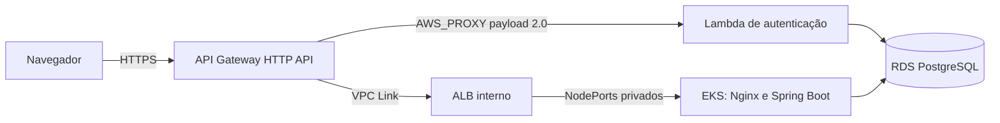

# Infraestrutura do AutoFlow

Este repositório declara a infraestrutura AWS do AutoFlow com Terraform. A arquitetura final é **Amazon API Gateway HTTP API, Lambda, VPC Link, ALB interno, EKS e RDS PostgreSQL**. Não há instalação ou roteamento Kong na configuração operacional.

O código e os documentos descrevem configuração versionada; não comprovam que esses recursos estejam atualmente implantados ou validados na AWS.

## Documentação da arquitetura

Leia na ordem: [arquitetura e diagramas C4](docs/api-gateway/arquitetura.md), [ADR-001](docs/api-gateway/adr-001-api-gateway.md), [RFC técnica](docs/api-gateway/rfc-api-gateway.md), [runbook operacional](docs/api-gateway/runbook.md). O [README do root Terraform](infra/api-gateway/README.md) contém validações locais.

O contrato central da aplicação está no [OpenAPI e guia da API](https://github.com/autoflow-fiap/autoflow/blob/develop/docs/openapi/README.md); a [coleção Postman de autenticação CPF/JWT](https://github.com/autoflow-fiap/autoflow/blob/develop/backend/postman/autoflow-serverless-auth.postman_collection.json) também é mantida no repositório da aplicação.

Os ambientes usam os mesmos roots Terraform: `develop` seleciona `homolog` e `main` seleciona `production`. Consulte o [catálogo de variables e secrets](docs/variables-and-secrets.md) para configurar, em cada GitHub Environment, a conta esperada, credenciais temporárias, bucket e keys do Terraform State. Use keys separadas por ambiente e por root. Os nomes dos seis roots e suas Variables de State estão na [tabela de ownership](docs/api-gateway/arquitetura.md#states-e-ownership). Required reviewers e políticas de branch devem ser auditados por uma identidade administrativa autorizada antes de habilitar o gate adicional; veja [execução e auditoria dos Environments](docs/github-runner.md#auditoria-administrativa-externa). Nenhum ID de conta ou credencial é versionado.

Para investigar nós EC2 que não registram no Kubernetes, consulte o [runbook de diagnóstico e recuperação EKS](docs/eks-node-recovery.md). O procedimento é somente leitura até a seção explícita de recuperação manual; não há reboot automatizado.

O root `infra/` e o workflow `Pipeline` gerenciam somente VPC/EKS. New Relic tem state e workflow independentes em [`infra/newrelic/`](infra/newrelic/README.md), sem duplicar recursos AWS de plataforma.

Para iniciar o ambiente, primeiro configure os GitHub Environments e valide o contrato dos seis States com `python scripts/terraform_state_contract.py <caminho-externo-para-configuracao.json>`. Esse comando local valida apenas o contrato informado; não acessa AWS nem prova a existência de States remotos. Em seguida, execute o [bootstrap S3 isolado](docs/state-bucket-bootstrap.md), e só depois faça dispatch separado para Plan/Apply conforme os gates. A [ordem geral de provisionamento](docs/api-gateway/runbook.md) e o [runbook de primeiro provisionamento EKS](docs/eks-primeiro-provisionamento.md) cobrem as dependências entre roots. API Gateway e New Relic iniciam por `workflow_dispatch` explícito depois que suas dependências estiverem prontas. Para New Relic, sincronize antes a License Key pela pipeline da aplicação e confirme que os workloads estão saudáveis. Para objetos New Relic preexistentes, siga o [runbook de migração de state](docs/newrelic-state-migration.md), sem executar migração em deploy normal.

A sequência de reconstrução e os limites dos procedimentos estão documentados no [runbook de primeiro provisionamento EKS](docs/eks-primeiro-provisionamento.md) e no [runbook do API Gateway](docs/api-gateway/runbook.md).

Para diagnóstico dos nós EKS, consulte o [runbook](docs/eks-node-recovery.md). O provisionamento da EC2 runner está descrito em [Runner privado do GitHub Actions](docs/github-runner.md).

## Orquestrador de pipelines — Fase 1

O orquestrador PowerShell consulta, valida e consolida informações do GitHub para `autoflow-infra`, `autoflow-db`, `autoflow-lambda` e `autoflow`. A Fase 1 é somente leitura: não dispara workflows, não altera Environments, Variables, Secrets ou AWS, e não substitui os gates nativos das pipelines.

```powershell
.\scripts\orchestration\Invoke-AutoFlowPipeline.ps1 -Environment homolog -Action status
.\scripts\orchestration\Invoke-AutoFlowPipeline.ps1 -Environment homolog -Action validate
.\scripts\orchestration\Invoke-AutoFlowPipeline.ps1 -Environment homolog -Action report -JsonPath "$env:TEMP\autoflow-report.json" -MarkdownPath "$env:TEMP\autoflow-report.md"
.\scripts\orchestration\Invoke-AutoFlowPipeline.ps1 -Environment homolog -Action report -DryRun
```

Consulte o [guia de uso, permissões e interpretação](docs/pipeline-orchestrator.md), a [arquitetura da Fase 1](docs/pipeline-orchestrator-architecture.md) e o [runbook de operação e troubleshooting](docs/pipeline-orchestrator-runbook.md). `validate` consulta `homolog` e `production` para avaliar isolamento das seis State Keys. Resultados de pipeline não comprovam que recursos AWS foram provisionados.

## Responsabilidades

- `infra/`: VPC, subnets, Security Groups, EKS e node group.
- `infra/api-gateway/`: HTTP API, rotas, integração nativa com Lambda, VPC Link, ALB interno, Target Groups e observabilidade.
- `autoflow`: Deployments, Services internos e NodePorts privados consumidos pelo ALB.
- `autoflow-lambda`: função de autenticação e execução em rede privada.
- `autoflow-db`: RDS PostgreSQL e controles de rede.

## Fluxo de requisições



O navegador usa a mesma origem HTTPS para frontend e API. O API Gateway invoca a Lambda diretamente; as integrações de negócio e frontend usam VPC Link e ALB interno. A Function URL antiga foi removida; a invocação da Lambda ocorre pela permissão restrita ao API Gateway.

## Ordem de implantação

Para cada ambiente, execute a sequência de dependências: (1) VPC/EKS e rede; (2) RDS e conectividade privada; (3) Lambda; (4) dispatch inicial de API Gateway, VPC Link e ALB interno; (5) aplicação no EKS; (6) New Relic após License Key e workloads saudáveis; (7) smoke tests ponta a ponta. Produção usa os recursos `autoflow-production`; homologação mantém `autoflow`. O procedimento está no [runbook](docs/api-gateway/runbook.md).

## States e pipelines

Os seis roots usam States S3 independentes por Environment: VPC/EKS, New Relic, aplicação, RDS, Lambda e API Gateway. As keys devem ser exclusivas por ambiente/root, usar prefixo `homolog/` ou `production/` e ser consumidas exatamente pelo root dependente. O validador de contrato de seis States recebe a matriz externamente e não é executado automaticamente por todos os workflows; consulte a tabela de ownership para as Variables observadas e limitações dos checkouts. Não inicialize State vazio sobre recursos existentes e não edite arquivos de State manualmente.

Para criar ou verificar o bucket backend sem iniciar Plan, Apply ou Terraform, siga o [procedimento isolado de bootstrap do bucket](docs/state-bucket-bootstrap.md).

### Validação integrada dos seis States

Execute os testes locais da política integrada, sem acesso à AWS:

```bash
python -m unittest discover -s scripts -p 'test_terraform_state_contract.py' -v
python -m unittest discover -s scripts -p 'test_terraform_deployment_fingerprint.py' -v
```

Para conferir a configuração efetiva antes de qualquer operação Terraform, prepare fora do checkout um JSON com os roots `vpc_eks`, `rds`, `lambda`, `application`, `api_gateway` e `newrelic` para ambos os Environments. Cada root informa `account_id`, `bucket`, `region` e `key`; roots consumidores também informam em `consumes` as keys recebidas dos produtores. O contrato compara RDS→VPC/EKS, Lambda→VPC/EKS e RDS, aplicação→RDS, API Gateway→VPC/EKS e New Relic→VPC/EKS. Obtenha os valores diretamente das Variables dos GitHub Environments e não registre o arquivo, valores reais, IDs, ARNs ou States no repositório ou nos logs.

```bash
python scripts/terraform_state_contract.py <caminho-externo-para-configuracao.json>
```

O comando exige prefixos por Environment, seis keys exclusivas por bucket, ausência de cruzamento entre homologação e produção, igualdade produtor/consumidor e correspondência de conta, bucket e região. Ele não inicializa backend, consulta objetos S3 ou lê conteúdo de State. Os testes usam apenas valores sintéticos e não definem sufixos autoritativos.

Os backends S3 recebem `allowed_account_ids` por `-backend-config`, derivada exclusivamente de `AWS_EXPECTED_ACCOUNT_ID` do Environment; o `terraform_remote_state` do API Gateway usa o mesmo valor externo. Não passe `expected_bucket_owner` ao Terraform 1.16.5. A verificação de ownership permanece nas operações AWS CLI compatíveis, como `head-object --expected-bucket-owner`, antes do init; essa checagem não lê nem imprime o conteúdo do State. Todos os inits remotos mantêm `encrypt=true` e `use_lockfile=true`.

### Validação local dos seis roots Terraform

Na raiz do workspace que contém os quatro repositórios, inicialize sem backend remoto e valide cada root (não use credenciais AWS para estes comandos):

```bash
terraform -chdir=autoflow-infra/infra init -backend=false -input=false
terraform -chdir=autoflow-infra/infra validate
terraform -chdir=autoflow-infra/infra/newrelic init -backend=false -input=false
terraform -chdir=autoflow-infra/infra/newrelic validate
terraform -chdir=autoflow-infra/infra/api-gateway init -backend=false -input=false
terraform -chdir=autoflow-infra/infra/api-gateway validate
terraform -chdir=autoflow/infra init -backend=false -input=false
terraform -chdir=autoflow/infra validate
terraform -chdir=autoflow-lambda/infra init -backend=false -input=false
terraform -chdir=autoflow-lambda/infra validate
terraform -chdir=autoflow-db/infra init -backend=false -input=false
terraform -chdir=autoflow-db/infra validate
```

Para verificar argumentos do backend contra o Terraform 1.16.5 sem acessar AWS, execute `python -m unittest discover -s autoflow-infra/scripts -p "test_terraform_backend_config.py" -v`. O teste de init S3 usa um bucket fictício, configuração temporária, sem credenciais e endpoint restrito a `127.0.0.1`; a falha de conexão local é esperada e nenhuma API AWS ou State remoto é alcançado.

CI executa em PRs; branches feature não acessam AWS nem executam Plan/Apply. Os jobs protegidos obtêm configuração diretamente de `${{ vars.* }}` e `${{ secrets.* }}` e falham antes de configurar credenciais AWS quando valores obrigatórios estão vazios, conta/região são inválidas ou State Keys não pertencem ao Environment selecionado. Nenhum workflow consulta APIs administrativas de Variables, Secrets ou proteção de Environments com `GITHUB_TOKEN`. A aprovação nativa do Environment continua ativa; `TERRAFORM_APPLY_APPROVAL_CONFIGURED=true` é um gate adicional e independente. Antes de definir esse marcador, valide externamente Required reviewers e políticas de branch com uma identidade administrativa autorizada. No workflow `Pipeline`, `approve_state_bucket_creation=true` inicia somente o job isolado de bootstrap e ignora `validate`, Plan e Apply; `apply`, `approve_eks_state_reconciliation` e `allow_destructive` devem ficar `false`. O Plan comum somente verifica existência, propriedade e controles do bucket. Plan e Apply posteriores exigem dispatch separado; Apply reutiliza o artifact criptografado, vinculado ao run/commit e ao fingerprint. `APPROVE_CREATE` era uma Variable legada do fluxo inline e não é consumida pelo workflow atual. Para recuperação de uma falha antiga HTTP 403, siga o [procedimento de bootstrap](docs/state-bucket-bootstrap.md#controles-falhas-e-recuperacao). Exclusões e substituições continuam bloqueadas por padrão. Consulte a [RFC](docs/api-gateway/rfc-api-gateway.md) e o [runbook](docs/api-gateway/runbook.md). Nenhum workflow instala gateways adicionais.

Use `AWS_PROFILE`, `AWS_REGION`, `AWS_EXPECTED_ACCOUNT_ID` e `TF_VAR_*` localmente. Antes do Plan VPC/EKS, `scripts/verify_eks_iam_roles.py --discover` identifica exatamente uma role de cluster e uma de node group por STS/IAM, validando conta, trust policies, AWS managed policies e a role do cluster existente. O Apply valida as roles gravadas no Plan aprovado, sem as redescobrir. Os guards são somente leitura e não alteram IAM. GitHub Actions Variables contêm conta, região, bucket e keys; credenciais e dados sensíveis permanecem em GitHub Secrets.
