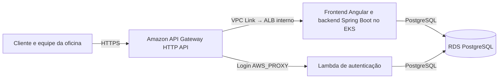
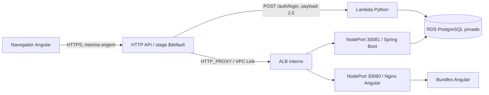
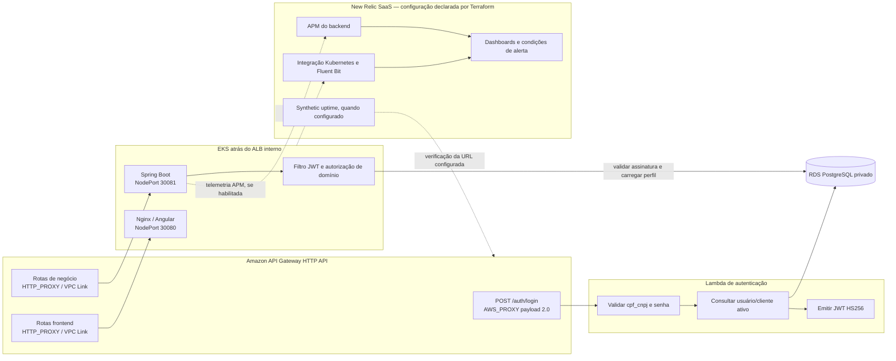
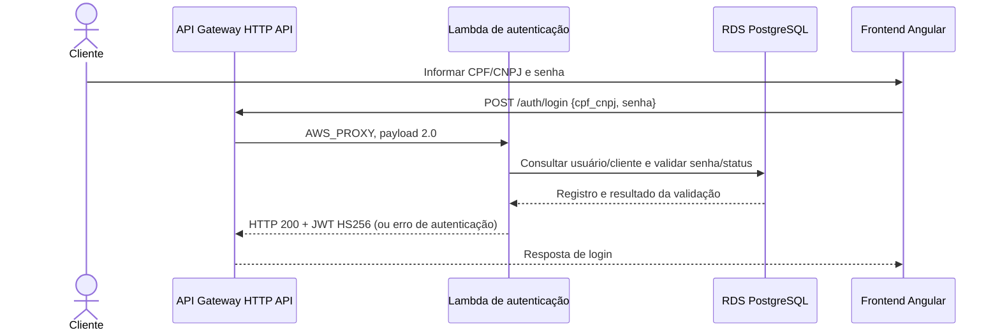
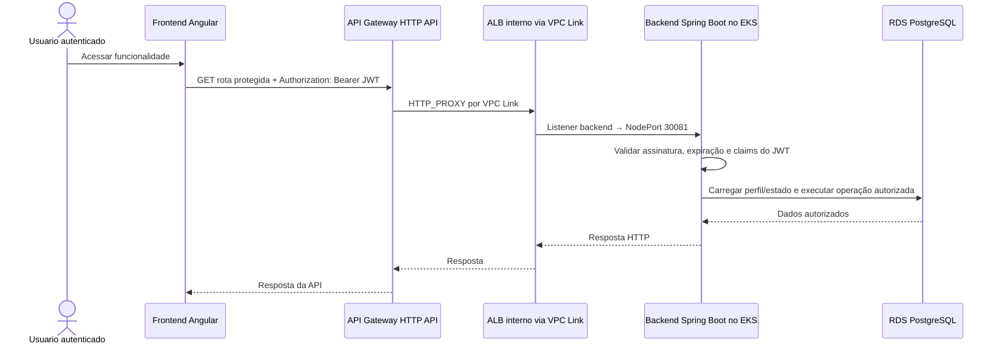
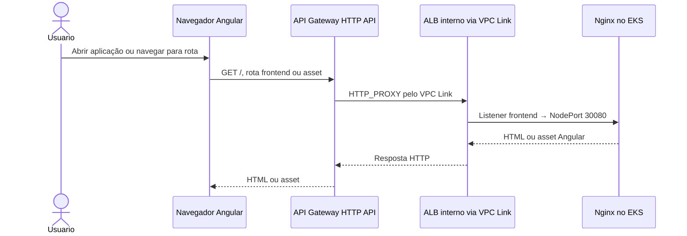
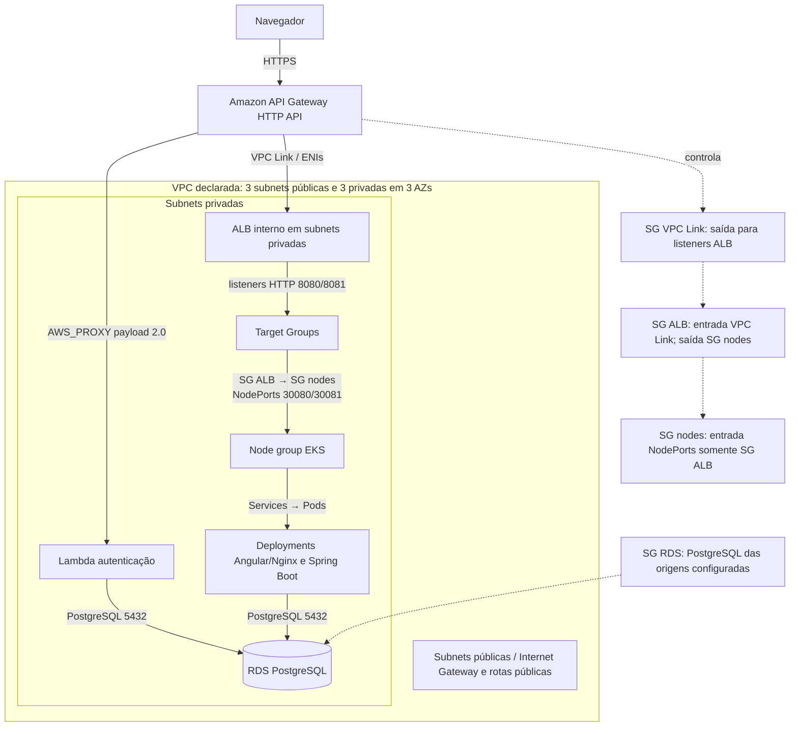
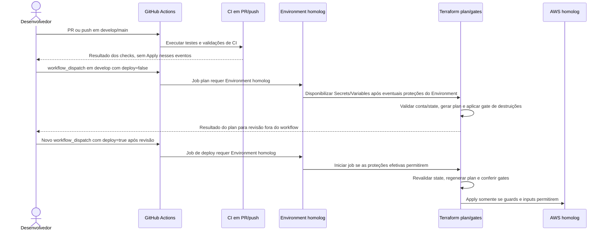

# Arquitetura final: AutoFlow com Amazon API Gateway

**Status:** arquitetura finalizada e configurada para provisionamento pelas pipelines CI/CD. Após reset do AWS Academy Learner Lab, execute novamente as pipelines para provisionar os recursos do ambiente.

Esta página consolida a arquitetura e os diagramas C4. A decisão arquitetural está registrada em [ADR-001](adr-001-api-gateway.md) e os detalhes de desenho/implantação em [RFC técnica](rfc-api-gateway.md).

## Decisão

1. Amazon API Gateway HTTP API v2 é a única entrada pública do AutoFlow.
2. `POST /auth/login` usa integração nativa `AWS_PROXY`, payload `2.0`, para a Lambda existente. A permissão `lambda:InvokeFunction` é restrita à conta e à rota.
3. Rotas de negócio e frontend usam integração `HTTP_PROXY` pelo VPC Link v2 para listeners de um ALB interno.
4. O ALB encaminha aos NodePorts `30081` (Spring Boot) e `30080` (Nginx/Angular), que seguem para Services e Pods do EKS.
5. Lambda e backend acessam o RDS PostgreSQL privado. O JWT HS256 emitido pela Lambda é validado pelo backend; perfis e estado do cliente são verificados no domínio.
6. A Function URL não faz parte do caminho de tráfego configurado. A integração nativa da HTTP API invoca a Lambda com permissão restrita à rota de login.

## C4 — contexto

## C4 — contêineres

## C4 — componentes

O contrato atualmente documentado pela Lambda usa `cpf_cnpj` e `senha`. O diagrama não implica que o API Gateway valide JWT: a validação e autorização de domínio das rotas protegidas são feitas pelo backend Spring Boot. New Relic, integração Kubernetes, APM, dashboards, alertas e Synthetic estão configurados para provisionamento pelos roots Terraform correspondentes. Após reset do Learner Lab, execute também a pipeline New Relic.

## Sequências de comunicação

### 1. Login CPF/CNPJ e emissão de JWT

### 2. Acesso autenticado ao backend

### 3. Acesso ao frontend Angular

As respostas negativas de login não geram JWT. Um JWT válido não substitui as verificações de perfil e estado do cliente no backend.

## C4 — implantação e rede

Terraform declara três subnets públicas e três privadas distribuídas em três AZs; ALB interno, VPC Link, EKS e RDS usam subnets privadas conforme seus roots. O SG do ALB permite o SG do VPC Link nos listeners 8080/8081 e saída ao SG dos nodes nas portas 30080/30081; os NodePorts aceitam tráfego somente do SG do ALB. O SG do RDS permite PostgreSQL às origens configuradas no root do banco. O tráfego privado VPC Link–ALB usa HTTP; TLS termina no endpoint gerenciado do API Gateway. Após reset do Learner Lab, reexecute as pipelines CI/CD para provisionar essa topologia.

## Rotas e autorização

A matriz executável está em [`routes.tf`](../../infra/api-gateway/routes.tf): 56 rotas de backend, 22 de frontend e uma rota de login. Não há rota catch-all. Rotas de negócio exigem JWT e autorização do Spring; endpoints públicos são somente os declarados no contrato. O API Gateway não substitui a autenticação de domínio.

O frontend chama `/auth/login` e as rotas de negócio no mesmo host. `cors_origins` e `gateway_cors_origins` permanecem allowlists exatas HTTPS para eventuais origens externas; não se usa wildcard.

## States e ownership

| Root proprietário | Responsabilidade final | Key |
|---|---|---|
| VPC/EKS (`autoflow-infra/infra`) | VPC, EKS e node group | `AWS_TF_STATE_KEY_INFRA`, fornecida pelo Environment |
| Aplicação (`autoflow/infra`) | Deployments, Services, NodePorts e ConfigMaps | `AWS_TF_STATE_KEY`, fornecida pelo Environment |
| RDS (`autoflow-db/infra`) | RDS PostgreSQL e rede do banco | `AWS_TF_STATE_KEY`, fornecida pelo Environment |
| Lambda (`autoflow-lambda/infra`) | Função Lambda e configuração de execução; a invocação é integrada à HTTP API, sem Function URL no caminho declarado | `AWS_TF_STATE_KEY`, fornecida pelo Environment |
| API Gateway (`autoflow-infra/infra/api-gateway`) | HTTP API, rotas, integração nativa Lambda, VPC Link, ALB, Target Groups e observabilidade | `AWS_TF_STATE_KEY_GATEWAY`, fornecida pelo Environment |
| New Relic (`autoflow-infra/infra/newrelic`) | Release Helm, dashboards, alertas e Synthetic | `AWS_TF_STATE_KEY_NEWRELIC`, fornecida pelo Environment |

Cada key começa pelo prefixo do Environment (`homolog/` ou `production/`), tem sufixo externo e é exclusiva no bucket. Consumidores recebem exatamente a key publicada pelo root produtor. Conta, bucket e região são selecionados no GitHub Environment; não há keys definitivas declaradas nesta documentação.

Os states permanecem separados. Nenhum state deve ser editado diretamente ou compartilhado entre contas.

## 4. Fluxo de implantação declarado nos workflows

O diagrama descreve os fluxos e gates declarados nos workflows. Após reset do Learner Lab, execute novamente as pipelines CI/CD para provisionar a arquitetura.

Não aplicar plans de destruição sem revisão. A ordem e os comandos de provisionamento estão no [runbook](runbook.md).
