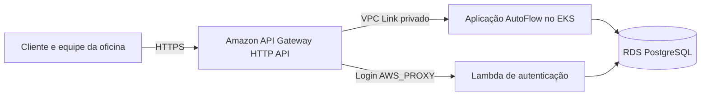
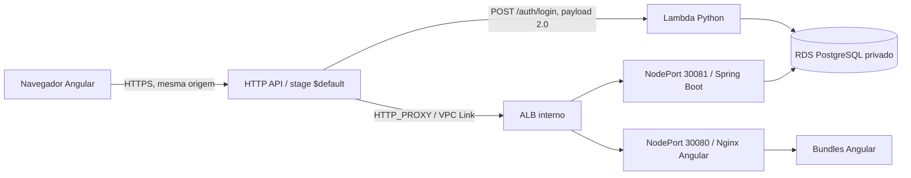
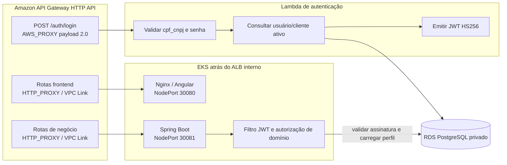
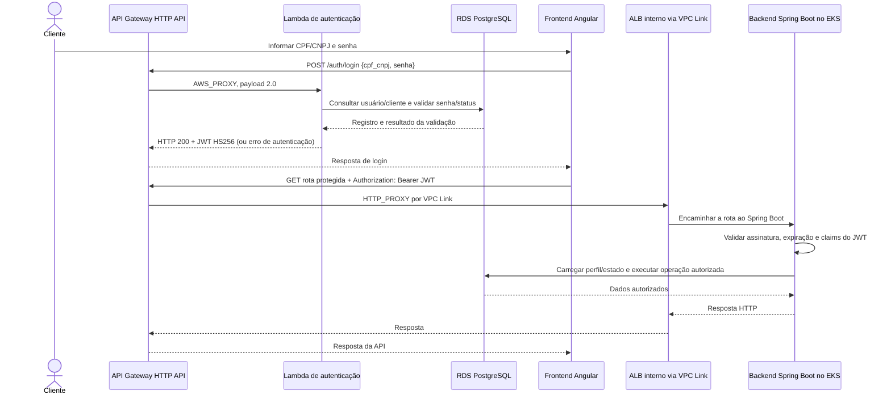
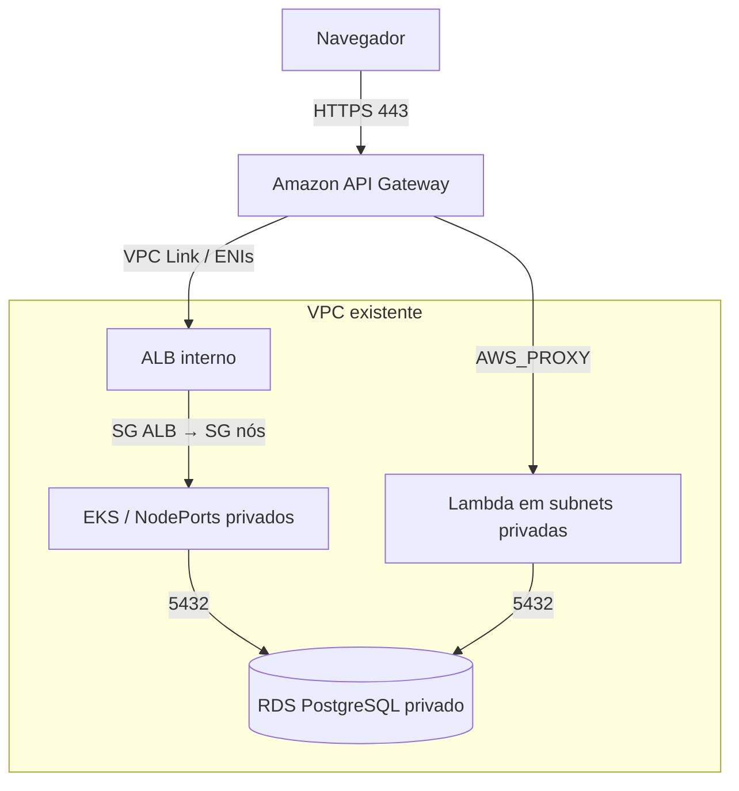

# Arquitetura final: AutoFlow com Amazon API Gateway

**Data:** 13/10/2026. **Status:** arquitetura implantada e homologada no ambiente Learner Lab. O checkpoint registra a remoção da Function URL e do runtime Kong, inclusive limpeza residual. Estas evidências são específicas daquele ambiente e não garantem estado em outra conta.

Esta página consolida a arquitetura e os diagramas C4. A decisão arquitetural está registrada em [ADR-001](adr-001-api-gateway.md) e os detalhes de desenho/implantação em [RFC técnica](rfc-api-gateway.md).

## Decisão

1. Amazon API Gateway HTTP API v2 é a única entrada pública do AutoFlow.
2. `POST /auth/login` usa integração nativa `AWS_PROXY`, payload `2.0`, para a Lambda existente. A permissão `lambda:InvokeFunction` é restrita à conta e à rota.
3. Rotas de negócio e frontend usam integração `HTTP_PROXY` pelo VPC Link v2 para listeners de um ALB interno.
4. O ALB encaminha aos NodePorts `30081` (Spring Boot) e `30080` (Nginx/Angular), que seguem para Services e Pods do EKS.
5. Lambda e backend acessam o RDS PostgreSQL privado. O JWT HS256 emitido pela Lambda é validado pelo backend; perfis e estado do cliente são verificados no domínio.
6. A Function URL não participa do caminho de tráfego e foi removida por Terraform. A permissão de invocação nativa da HTTP API permanece; a Lambda não depende de Function URL.

## Evidência em homologação

API `4ct2k9m5l8`, stage `$default`, 79 rotas e 48 integrações. VPC Link `cjhmlk` `AVAILABLE`; ALB `autoflow-homolog-private` `active/internal`. Target Groups backend/frontend: 2/2 `healthy`. RDS disponível, backend `db:UP`, 47 migrations Flyway validadas e schema atualizado. Login válido de cliente seed, emissão de JWT e consulta autenticada pelo backend retornaram HTTP 200. Smokes de autenticação negativa, CORS não autorizado, assets e deep links também passaram.

Essas evidências descrevem o ambiente verificado em 13/10/2026; não substituem validação em outra conta ou região.

## C4 — contexto

## C4 — contêineres

## C4 — componentes

O contrato atualmente documentado pela Lambda usa `cpf_cnpj` e `senha`. O diagrama não implica que o API Gateway valide JWT: a validação e autorização de domínio das rotas protegidas são feitas pelo backend Spring Boot.

## Sequência de login e chamada autenticada

As respostas negativas de login não geram JWT. Um JWT válido não substitui as verificações de perfil e estado do cliente no backend.

## C4 — implantação e rede

O SG do ALB permite somente o SG do VPC Link nas portas dos listeners e permite saída somente ao SG dos nós nas portas NodePort. Os NodePorts recebem tráfego apenas do SG do ALB. O RDS permanece privado. O tráfego privado entre VPC Link e ALB usa HTTP; TLS termina no endpoint gerenciado do API Gateway.

## Rotas e autorização

A matriz executável está em [`routes.tf`](../../infra/api-gateway/routes.tf): 56 rotas de backend, 22 de frontend e uma rota de login. Não há rota catch-all. Rotas de negócio exigem JWT e autorização do Spring; endpoints públicos são somente os declarados no contrato. O API Gateway não substitui a autenticação de domínio.

O frontend chama `/auth/login` e as rotas de negócio no mesmo host. `cors_origins` e `gateway_cors_origins` permanecem allowlists exatas HTTPS para eventuais origens externas; não se usa wildcard.

## States e ownership

| State | Responsabilidade final |
|---|---|
| `eks/terraform.tfstate` | VPC, EKS e node group |
| `application/autoflow/terraform.tfstate` | Deployments, Services, NodePorts e ConfigMaps da aplicação |
| `rds/terraform.tfstate` | RDS PostgreSQL e rede do banco |
| `lambda/terraform.tfstate` | Lambda e configuração transitória IAM-only da Function URL |
| `api-gateway/terraform.tfstate` | HTTP API, rotas, integração nativa Lambda, VPC Link, ALB, Target Groups e observabilidade |

Os states permanecem separados. Nenhum state deve ser editado diretamente ou compartilhado entre contas.

## Histórico da retirada do legado

Os plans aprovados removeram os Ingresses/recursos Kong antigos e a release Helm que possuía o Service `LoadBalancer` responsável pelo NLB. O ALB interno, HTTP API, VPC Link, EKS, Lambda, RDS, Services internos, Deployments, NodePorts 30080/30081 e states dos outros componentes foram preservados no checkpoint.

Helm não remove automaticamente CRDs durante `helm uninstall`. No ambiente homologado, as CRDs foram verificadas sem objetos customizados e removidas; a instalação acadêmica separada também foi desinstalada. A consulta posterior não encontrou recursos AWS residuais exclusivos do Kong nem regras candidatas. Em outra conta, repetir inventário e aprovação antes de qualquer limpeza.

Não aplicar plans de destruição antes da aprovação. A ordem e os comandos de revisão estão no [runbook](runbook.md) e as evidências do checkpoint em [progresso](progresso.md).
