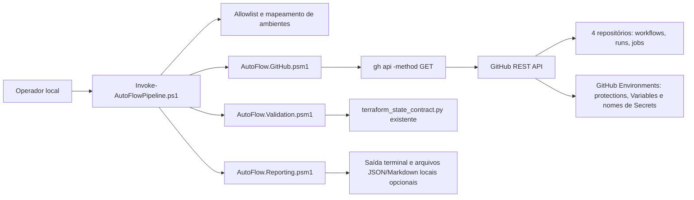

# Arquitetura do orquestrador de pipelines — Fase 1

## Decisão e limites

A Fase 1 implementa uma CLI PowerShell local que consulta o estado operacional declarado no GitHub para os quatro repositórios do AutoFlow. A fonte de autenticação é a sessão já existente do GitHub CLI. Não é criado token próprio, serviço residente, credencial administrativa ou integração AWS.



Não existe aresta de escrita para GitHub ou AWS. Não há etapa Terraform, chamada AWS CLI, execução de workflow, alteração de segredo/variável, aprovação automática ou leitura de State remoto.

## Componentes

| Componente | Responsabilidade |
|---|---|
| `AutoFlow.Config.psm1` | Allowlist fixa dos quatro repositórios, mapeamento de `homolog`/`production`, variáveis e associação dos seis roots. |
| `AutoFlow.GitHub.psm1` | Chamadas GitHub somente GET via `gh`, paginação, validação de payloads, classificação de erros e parsing de workflows/runs/jobs. |
| `AutoFlow.Validation.psm1` | Consulta ambos os Environments, protege o significado de `UNKNOWN`/`ACCESS_DENIED` e monta contrato de State sem reimplementar as regras Python. |
| `AutoFlow.Reporting.psm1` | Saída humana, relatório agregado, recomendações manuais e exportação local redigida. |
| `Invoke-AutoFlowPipeline.ps1` | Validação de parâmetros, dry-run e seleção de ação. |
| `tests/AutoFlow.Orchestration.Tests.ps1` | Testes Pester com transportes simulados, sem rede e sem AWS. |

## Modelo dos ambientes e dependências

Nos workflows observados, `develop` corresponde a `homolog` e `main` a `production`. A validação consulta ambos os ambientes em cada um dos quatro repositórios, porque as seis State Keys precisam ser verificadas em conjunto. O status consulta apenas a branch do ambiente solicitado.

O contrato de State recebe os valores consultados das Environment Variables e associa os roots desta forma:

```text
vpc_eks -> AWS_TF_STATE_KEY_INFRA (autoflow-infra)
rds -> AWS_TF_STATE_KEY (autoflow-db), consome AWS_INFRA_STATE_KEY
lambda -> AWS_TF_STATE_KEY (autoflow-lambda), consome AWS_INFRA_STATE_KEY e AWS_RDS_STATE_KEY
application -> AWS_TF_STATE_KEY (autoflow), consome o default rds/terraform.tfstate observado
api_gateway -> AWS_TF_STATE_KEY_GATEWAY (autoflow-infra), consome AWS_TF_STATE_KEY_INFRA
newrelic -> AWS_TF_STATE_KEY_NEWRELIC (autoflow-infra), consome AWS_TF_STATE_KEY_INFRA
```

O orquestrador grava temporariamente o documento necessário ao helper Python fora do checkout e o remove em `finally`. O documento não inclui Secrets, tokens ou respostas HTTP. Os valores não são incorporados ao relatório.

## Estados e falha segura

As respostas HTTP são analisadas em conjunto com status e conteúdo. Um comando `gh` com exit code zero não basta para considerar uma resposta válida. Payload sem campos obrigatórios, JSON inválido ou coleção truncada é `INVALID_RESPONSE`. HTTP 403 é `ACCESS_DENIED`, exceto rate limit reconhecível. Um Environment só é marcado ausente se o inventário responder validamente sem ele; 404 direto de Environment/branch e 404 de repositório permanecem ambíguos entre ausência e invisibilidade por permissões.

Uma falha de autorização, rate limit, timeout, endpoint indisponível, resposta malformada ou dado insuficiente não vira ausência de configuração nem aprovação implícita. Os códigos de saída são `0` sucesso, `1` inconsistência confirmada, `2` argumentos/opções inválidos e `3` erro/indisponibilidade/estado desconhecido.

O status do GitHub Actions preserva o status da execução (`queued`, `in_progress`, `waiting`, `completed`) e a conclusão (`failure`, `cancelled`, `skipped`, `success` ou valor retornado). Conclusão nula permanece não informada. Quando run/job está `waiting`, a API GET `pending_deployments` pode confirmar o Environment pendente e metadados de reviewer; o orquestrador não consulta identidades nem aprova.

## Dados e segredo

O endpoint de Secrets é usado apenas para listar nomes. Valores de Secrets nunca são solicitados. Values de Variables são lidos em memória porque são necessários para conferir conta, região, bucket, keys e o marcador de aprovação; não são emitidos no terminal, retornados em relatório, escritos em logs ou mantidos em arquivo, exceto o documento temporário não secreto de contrato que é removido ao terminar. JSON e Markdown de relatório contêm nomes, status, IDs/URLs, hashes de commit e achados sem valores de configuração.

## Evolução

A Fase 2 permanece planejamento. Qualquer automação de coordenação que dispare workflow, altere configurações, interaja com AWS ou aprove deployments requer especificação própria, autorização explícita e revisão dos controles de segurança. A Fase 1 não habilita essas ações por parâmetro e não altera workflows existentes.
