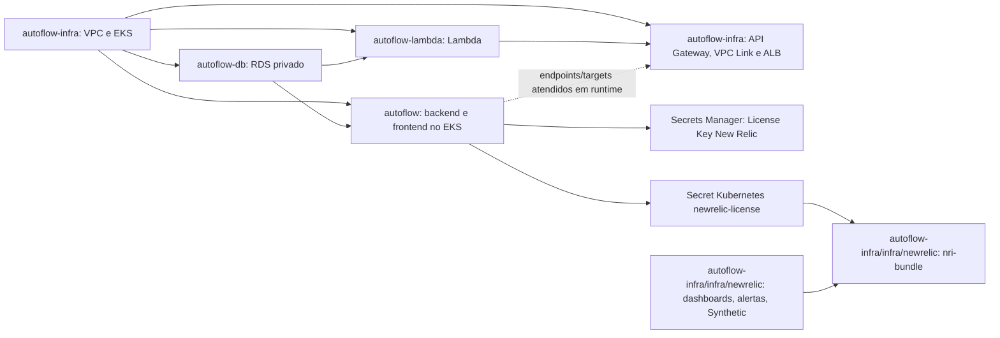

# Reconstrução de homologação após reset do AWS Academy Learner Lab

Este guia descreve o fluxo declarado nos workflows e Terraform locais dos repositórios `autoflow-infra`, `autoflow-db`, `autoflow-lambda` e `autoflow`. Não comprova que os recursos, credenciais, proteções GitHub ou permissões estão ativos na conta atual. Não reutilize state vazio se recursos sobreviveram ao reset.

## Arquitetura e dependências



Dependências comprovadas pelos roots e seus workflows:

| Root | Dependências obrigatórias | Evidência operacional |
|---|---|---|
| VPC/EKS (`autoflow-infra/infra`) | Nenhuma dependência de Terraform remoto | Provisiona VPC, subnets, cluster e node group. Não instala nem planeja New Relic. |
| RDS (`autoflow-db/infra`) | State EKS, VPC/subnets e cluster | Terraform lê `private_subnet_ids` e `eks_cluster_name` do state EKS. O pipeline exige state EKS e bloqueia exclusões/substituições. |
| Lambda (`autoflow-lambda/infra`) | States EKS e RDS | Terraform lê subnet privada do EKS e SG/endpoint do RDS. Workflow exige ambos os objects de state. |
| Aplicação (`autoflow/infra`) | EKS acessível, state RDS e API Gateway existente | Terraform consulta EKS, lê RDS e descobre o endpoint público do API Gateway; Apply também grava Secrets Kubernetes e sincroniza a License Key New Relic. |
| API Gateway (`autoflow-infra/infra/api-gateway`) | State/cluster/node group EKS e Lambda existente | Terraform lê VPC/subnets do state EKS, consulta EKS/node group e Lambda por data sources. Não lê state RDS e não depende diretamente de executar o workflow RDS. |
| New Relic (`autoflow-infra/infra/newrelic`) | VPC/EKS e aplicação disponíveis | State S3 próprio; descobre cluster, confirma node groups ativos, acesso Kubernetes e Deployments/Services da aplicação prontos; valida Secret quando o agente Kubernetes está habilitado. Inventaria ownership remoto antes de criar. |

O Terraform do API Gateway não declara dependência direta do state RDS nem da aplicação: exige Lambda, EKS e node group ativos e pode criar VPC Link/ALB antes de haver targets saudáveis. A aplicação, por sua vez, precisa descobrir o endpoint do API Gateway. Portanto, para reconstrução limpa, o gateway antecede a aplicação; a validação ponta a ponta ocorre depois de ambas.

## Ordem de reconstrução declarada

### Cenários para New Relic

- **Cenário A — reconstrução após reset:** executar VPC/EKS uma vez pelo workflow `Pipeline`; sincronizar a License Key pelo pipeline da aplicação; só então executar `New Relic Pipeline`. Confirmar state legado sem recursos New Relic e inventário remoto ausente. Não há `state mv`, `state rm` nem importação quando não existem objetos anteriores.
- **Cenário B — objetos/state sobreviventes:** parar diante de qualquer objeto remoto New Relic, endereço no state legado/novo ou inventário incompleto. A pipeline normal falha fechada. Com autorização explícita, executar o [runbook de migração](newrelic-state-migration.md), conferir cada address/ID remoto, fazer backup dos states e validar Plans dos dois roots antes de liberar deploys.

Ambos os workflows New Relic e VPC/EKS usam os Environments `homolog` (`develop`) e `production` (`main`) e exigem Required reviewers efetivos para Apply. New Relic preserva a passphrase de criptografia de Plan existente, checksums e artifact de curta retenção vinculado ao commit. Não iniciar Plans de deploy em branches feature.

1. **Bootstrap e credenciais**: iniciar o Learner Lab, obter credenciais temporárias da mesma sessão, configurar bucket Terraform State e keys, conta/região e proteções do GitHub. O workflow VPC/EKS tem preflight/bootstrap seguro do bucket; ausência conclusiva pode criar bucket somente pelo caminho aprovado, enquanto AccessDenied/erro ambíguo bloqueia. Se State não existir, recursos de rede sobreviventes só são reconciliados no `workflow_dispatch` com `approve_eks_state_reconciliation=true`; a pipeline gera import blocks somente para VPC, subnets privadas, route table privada e associações cuja conta, CIDR, tags e IDs correspondam exatamente ao root. Outros recursos remanescentes fora desse mapeamento (por exemplo, subnet pública, IGW, NAT, SG ou cluster EKS sem State) bloqueiam o Plan para evitar duplicação e exigem reconciliação específica. Se não houver recursos sobreviventes, o primeiro provisionamento segue normalmente; State existente continua sendo usado.
2. **VPC/EKS**: executar `Pipeline` em `autoflow-infra/develop`, aplicar VPC, subnets, cluster, node group e outputs do State. Required reviewers continuam obrigatórios. Esta etapa deve terminar antes dos consumers de `eks/terraform.tfstate`.
3. **RDS**: executar `RDS Pipeline` em `autoflow-db/develop`. O workflow exige o State EKS; o root consome subnet IDs e nome do cluster pelos outputs Terraform e bloqueia exclusões/substituições.
4. **Lambda**: executar `Lambda Pipeline` em `autoflow-lambda/develop`. Exige States EKS e RDS; publica pacote imutável no bucket Terraform State, sem bucket adicional, e usa o Plan/artifact daquela execução.
5. **API Gateway**: executar `Migração HTTP API` em `autoflow-infra/develop`. Exige EKS/node group ativos, State EKS e Lambda existente. Pode criar VPC Link e ALB antes da aplicação; seus targets ainda não estarão saudáveis.
6. **Aplicação**: executar `Pipeline` em `autoflow/develop`. Exige EKS acessível, State RDS e API Gateway existente; descobre cluster e endpoint público. Após aprovação, publica imagens, atualiza Secrets Kubernetes e, com `ENABLE_NEWRELIC_APM=true`, sincroniza License Key do Secrets Manager para `Secret/newrelic-license`.
7. **New Relic**: executar independentemente `New Relic Pipeline` em `autoflow-infra/develop`, após aplicação pronta e sincronização da License Key. O preflight exige EKS/node groups ativos, Deployments/Services AutoFlow prontos e, quando habilitado, Secret válido. Usa State próprio e não reaplica infraestrutura. Para dashboards, alertas e Synthetic, configure as flags/inputs de `homolog`.
8. **Validar**: executar smokes da aplicação e conferir API Gateway, VPC Link, ALB/targets, frontend, login e rota autenticada.

Na reconstrução definida, nenhuma etapa de provisionamento entre 2 e 7 pode ser executada em paralelo: cada uma consome outputs/recursos da anterior. Apenas CI estático e validações locais independentes podem correr em paralelo. Os workflows permanecem independentes e não são disparados automaticamente em cadeia. RDS, Lambda, aplicação e API Gateway executam Apply após o respectivo gate do Environment em `develop`; VPC/EKS e New Relic exigem `workflow_dispatch` com `apply=true`. Não use push como mecanismo de reconstrução deliberado.

### Diagrama da sequência atual

```mermaid
sequenceDiagram
  actor Operador
  participant I as autoflow-infra: VPC/EKS
  participant D as autoflow-db: RDS
  participant L as autoflow-lambda: Lambda
  participant A as autoflow: aplicação + License Key
   participant N as autoflow-infra/infra/newrelic: New Relic
  participant G as autoflow-infra: API Gateway
   Operador->>I: Dispatch Plan/Apply VPC/EKS + aprovação
   I-->>Operador: EKS/node group disponível
  Operador->>D: Dispatch; Plan + aprovação/Apply
  Operador->>L: Dispatch; Plan + aprovação/Apply
   Operador->>G: Dispatch do workflow API Gateway; Plan + aprovação/Apply
   Operador->>A: Dispatch; build/publicação + Plan + aprovação/Apply
   A-->>A: Sincroniza License Key em Secrets Manager e Kubernetes
   Operador->>N: Dispatch independente New Relic; Plan + aprovação/Apply
  Operador->>A: Smoke tests (dispatch opcional ou pós-deploy)
```

## GitHub: configuração necessária

Configurar os dados abaixo em cada repositório/Environment conforme os catálogos locais `docs/variables-and-secrets.md` dos quatro repositórios. Os nomes são referências, não valores a copiar. `homolog` e `production` devem permanecer isolados; a reconstrução deste guia usa apenas `develop`/`homolog`.

| Repositório | Secrets relevantes | Variables relevantes |
|---|---|---|
| `autoflow-infra` | Credenciais temporárias AWS `AWS_ACCESS_KEY_ID`, `AWS_SECRET_ACCESS_KEY`, `AWS_SESSION_TOKEN`; `TERRAFORM_PLAN_ENCRYPTION_PASSPHRASE`; `NEW_RELIC_API_KEY` | `AWS_REGION`, `AWS_EXPECTED_ACCOUNT_ID`, `AWS_TERRAFORM_STATE_BUCKET`, keys de State, CORS, flags/inputs New Relic e proteção de aprovação. As roles de cluster/node e a role operador são descobertas após validação STS/IAM; não cadastrar ARNs. Cluster, Lambda e node group são descobertos. |
| `autoflow-db` | Credenciais AWS; `DATABASE_USERNAME`, `DATABASE_PASSWORD` | Região/conta/bucket, keys RDS/EKS e proteção de aprovação. Cluster é lido do output do State EKS. |
| `autoflow-lambda` | Credenciais AWS; `DATABASE_USERNAME`, `DATABASE_PASSWORD`, `JWT_SECRET` | Região/conta/bucket, keys EKS/RDS/Lambda, ARN da role de execução e proteção de aprovação. Nome Lambda e bucket de pacote não são configurados à parte. |
| `autoflow` | Credenciais AWS; `TF_PLAN_ENCRYPTION_KEY`; `DOCKERHUB_PASSWORD`; secrets de aplicação `AUTOFLOW_*`; `NEW_RELIC_LICENSE_KEY` no Environment homolog | Região/conta/bucket/key aplicação, Docker Hub, CORS, `ENABLE_NEWRELIC_APM`, `NEW_RELIC_LICENSE_SECRET_ID` e proteção de aprovação. Cluster e endpoint API Gateway são descobertos. |

Os pipelines não compartilham automaticamente secrets entre repositórios. Configure-os no escopo onde são consumidos. Credenciais AWS Academy são temporárias e precisam ser renovadas no reinício da sessão. Configure Required reviewers efetivos em cada Environment `homolog`; a variável de guard não substitui a regra do GitHub. `AWS_EXPECTED_ACCOUNT_ID` é configuração externa e deve ser comparada com `sts get-caller-identity` pelos jobs; nenhum ID deve ser embutido em uma proposta de orquestração.

## Plan, Apply, state e segurança

- Para cada root, o workflow faz CI, Plan e publica artifact temporário do plan (os detalhes de criptografia/metadata variam por repositório). Apply consome o artifact daquela execução e verifica hash/commit/configuração antes de aplicar o binário aprovado; nunca gerar plan novo depois da aprovação para aplicar outro conteúdo.
- RDS/Lambda/aplicação/gateway usam `develop` para homolog. `main` não é caminho de reconstrução de homolog e deve permanecer separado como production quando o workflow suporta produção.
- VPC/EKS usa o Environment selecionado pela branch; dispatch em `main` é production. Em `develop`, dispatch com `apply=true` habilita Apply; branch/inputs de destruição não substituem Required reviewers.
- Guard destrutivo e de identidade é específico por root. RDS e Lambda bloqueiam ações destrutivas; VPC/EKS, API Gateway e New Relic têm guards e approvals explícitos. O root legado bloqueia exclusões New Relic. Revisar o resumo do Plan; não autorizar destruição para contornar erro de state.
- Bootstrap de bucket no pipeline `autoflow-infra` é condicionado pelo input `approve_state_bucket_creation`, cujo default é `false`; somente um `workflow_dispatch` com aprovação explícita pode criar o bucket ausente. Pushes não autorizam a criação. A reconciliação de rede tem gate separado, `approve_eks_state_reconciliation`, também `false` por default. Com esse gate, a pipeline pode preparar imports declarativos apenas para os recursos VPC/subnets privadas/route table/associações com correspondência inequívoca. A reconciliação de Access Entry/Policy EKS usa o mesmo gate. A aplicação do Plan continua no Environment protegido por Required reviewers; importar não autoriza Apply. Divergências não suportadas ou ambíguas interrompem o fluxo para reconciliação específica, sem exclusão ou substituição automática. Preservar criptografia, versionamento e bloqueio de acesso público no bucket.
- A License Key da aplicação e a New Relic User API key são segredos distintos. A License Key de runtime fica no Environment `homolog` do repositório `autoflow`, e é reconciliada com Secrets Manager/Kubernetes; a User API key no `autoflow-infra` permite inventário remoto e provider de recursos de conta.

## Validação

Antes de plan/apply, confirmar sessão, conta e região:

```bash
aws sts get-caller-identity
python scripts/verify_aws_account.py
```

Validações locais sem backend para cada checkout (não aplicam recursos):

```bash
terraform -chdir=infra fmt -check -recursive
terraform -chdir=infra init -backend=false -input=false
terraform -chdir=infra validate
```

Para o gateway, executar também `terraform -chdir=infra/api-gateway test`. Após provisionamento, validar status EKS/node group `ACTIVE`, RDS `available`, Lambda `Active`, endpoints e targets do gateway, rollout da aplicação e os smoke tests `python scripts/smoke_api_gateway.py` com os argumentos/configuração homolog apropriados. Nunca colocar tokens ou credenciais de teste em logs.

## Falhas e recuperação

| Sintoma | Ação segura |
|---|---|
| Credencial expirada, conta/região diferente ou AccessDenied | Parar; reabrir Learner Lab, renovar a sessão, conferir identidade/escopo de permissão e repetir preflight. Não reinterpretar negação como recurso ausente. |
| Bucket ou state ausente | Verificar bucket/key e inventário. Bootstrap somente pela opção autorizada do workflow. Para state ausente com recurso existente, interromper e planejar import/adopção com revisão própria; não aplicar root sobre state vazio. |
| Plan destrutivo/inesperado | Não aprovar. Conferir state, inventário e recurso remoto; recuperar state ou corrigir inputs e gerar novo Plan/artifact. |
| Falha parcial após Apply | Registrar etapa e outputs, verificar recursos e state de cada root, manter os roots já concluídos. Retomar a partir do primeiro pré-requisito ainda ausente com novo Plan; não reaplicar artifact antigo contra state alterado. |
| EKS pronto, mas New Relic falha | Confirmar `ENABLE_NEWRELIC_APM`, configuração externa, identidade/região, ausência de conflito de state e Secret Kubernetes. Aplicação deve sincronizar primeiro; então regenerar Plan de `New Relic Pipeline`. |
| RDS inacessível à aplicação/Lambda | Conferir SGs, endpoint e states EKS/RDS; não recriar banco como tentativa. Snapshots/dados não são revertidos por rollback Terraform. |
| Gateway criado sem targets saudáveis | Verificar rollout e Services/NodePorts da aplicação, ALB/Target Groups e VPC Link. Corrigir declarativamente e gerar plan quando recursos Terraform mudarem. |

Não executar `terraform destroy`, editar state manualmente, trocar de conta para prosseguir ou remover recursos compartilhados. Rollback é uma mudança declarativa nova, com novo Plan e aprovação.

## Intervenções manuais que permanecem

No fluxo atual, uma pessoa precisa reativar/renovar Learner Lab e secrets AWS, iniciar cada workflow necessário, inspecionar Plans, aprovar cada Apply no Environment e executar validação/smoke. O cenário A usa states vazios somente após confirmar ausência remota, sem migração. O cenário B exige autorização e segue o [runbook de migração](newrelic-state-migration.md), separado do deploy normal. A orquestração central permanece trabalho separado: a análise/prova mínima `autoflow-infra` → `autoflow-lambda` está no [plano de implementação](specs/reconstrucao-learner-lab/plano-implementacao.md), e não chama pipelines de deploy.

## Fontes locais

`.github/workflows/pipeline.yml` e `api-gateway.yml`, `infra/*.tf`, `docs/eks-primeiro-provisionamento.md`, `docs/variables-and-secrets.md` neste repositório; e os workflows, Terraform e `docs/variables-and-secrets.md` de `autoflow-db`, `autoflow-lambda` e `autoflow`. As configurações efetivas dos Environments e a disponibilidade atual da AWS não foram verificadas nesta análise.
