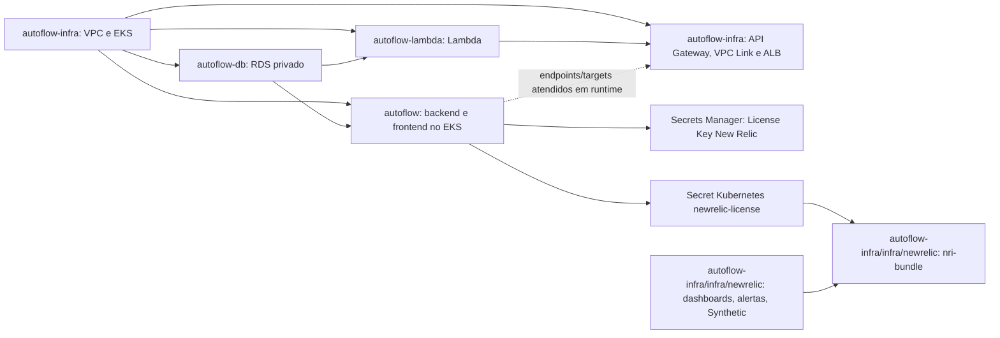

# Reconstrução de homologação após reset do AWS Academy Learner Lab

Este guia descreve o fluxo declarado nos workflows e Terraform locais dos repositórios `autoflow-infra`, `autoflow-db`, `autoflow-lambda` e `autoflow`. Não comprova que os recursos, credenciais, proteções GitHub ou permissões estão ativos na conta atual. Não reutilize state vazio se recursos sobreviveram ao reset.

## Arquitetura e dependências



Dependências comprovadas pelos roots e seus workflows:

| Root | Dependências obrigatórias | Evidência operacional |
|---|---|---|
| VPC/EKS (`autoflow-infra/infra`) | Nenhuma dependência de Terraform remoto | Provisiona VPC, subnets, cluster e node group. Não instala nem planeja New Relic. |
| New Relic (`autoflow-infra/infra/newrelic`) | VPC/EKS existentes e, para Helm, cluster/node group `ACTIVE`, acesso Kubernetes e Secret | State S3 próprio; consulta EKS existente e verifica o Secret. Guards comparam o state legado/novo e inventário remoto antes de criar. |
| RDS (`autoflow-db/infra`) | State EKS, VPC/subnets e cluster | Terraform lê `private_subnet_ids` do state `eks/terraform.tfstate` e consulta o cluster. O pipeline exige state EKS e bloqueia exclusões/substituições. |
| Lambda (`autoflow-lambda/infra`) | States EKS e RDS | Terraform lê subnet privada do EKS e SG/endpoint do RDS. Workflow exige ambos os objects de state. |
| Aplicação (`autoflow/infra`) | EKS acessível e state RDS | Terraform consulta EKS e lê RDS remoto; Apply também grava Secrets Kubernetes e sincroniza New Relic. |
| API Gateway (`autoflow-infra/infra/api-gateway`) | State/cluster/node group EKS e Lambda existente | Terraform lê VPC/subnets do state EKS, consulta EKS/node group e Lambda por data sources. Não lê state RDS e não depende diretamente de executar o workflow RDS. |

O Terraform do API Gateway não declara dependência de state RDS. Ele exige Lambda, EKS e node group ativos. O serviço precisa da aplicação atendendo nos targets para o caminho de negócio ficar saudável, mas isso é dependência funcional/runtime, não requisito para criar API Gateway, VPC Link e ALB. Recomenda-se provisionar aplicação antes do gateway para o smoke ponta a ponta.

## Ordem de reconstrução declarada

### Cenários para New Relic

- **Cenário A — reconstrução após reset:** executar VPC/EKS uma vez pelo workflow `Pipeline`; sincronizar a License Key pelo pipeline da aplicação; só então executar `New Relic Pipeline`. Confirmar state legado sem recursos New Relic e inventário remoto ausente. Não há `state mv`, `state rm` nem importação quando não existem objetos anteriores.
- **Cenário B — objetos/state sobreviventes:** parar diante de qualquer objeto remoto New Relic, endereço no state legado/novo ou inventário incompleto. A pipeline normal falha fechada. Com autorização explícita, executar o [runbook de migração](newrelic-state-migration.md), conferir cada address/ID remoto, fazer backup dos states e validar Plans dos dois roots antes de liberar deploys.

Ambos os workflows New Relic e VPC/EKS usam os Environments `homolog` (`develop`) e `production` (`main`) e exigem Required reviewers efetivos para Apply. New Relic preserva a passphrase de criptografia de Plan existente, checksums e artifact de curta retenção vinculado ao commit. Não iniciar Plans de deploy em branches feature.

1. **Preparar o ambiente**: iniciar o Learner Lab, renovar as credenciais temporárias em conjunto, verificar conta/região e confirmar configurações GitHub. Não iniciar plan/apply se a identidade externa divergir.
2. **Bootstrap/recuperar Terraform State**: verificar bucket e keys antes de roots dependentes. O workflow `Pipeline` de `autoflow-infra` inclui bootstrap de bucket no job de Plan; o input `approve_state_bucket_creation` está com default `true` no workflow atual. Portanto, ao usar `workflow_dispatch`, confira e ajuste conscientemente esse input antes de iniciar; o valor atual não exige uma escolha afirmativa manual. O bootstrap cria/configura o bucket somente quando detecta ausência conclusiva e falha fechado em AccessDenied/erro ambíguo; para bucket existente, apenas verifica controles. Um erro de acesso não significa bucket ausente. Em reset parcial, inventariar recursos sobreviventes e recuperar/importar state antes de plan; não aplicar state vazio sobre recursos existentes.
3. **VPC/EKS**: executar `Pipeline` em `autoflow-infra`, branch `develop`, com `apply=true` no dispatch. Plan/Apply provisionam ou reconciliam rede, EKS e node group. Required reviewers do Environment `homolog` continuam necessários. New Relic é completamente separada e não participa deste Plan.
4. **RDS**: executar o workflow `RDS Pipeline` em `autoflow-db/develop`. Plan/Apply exige state EKS e revisão de exclusões; o guard atual bloqueia exclusões/substituições sem override.
5. **Lambda**: executar `Lambda Pipeline` em `autoflow-lambda/develop`. Requer EKS e RDS; publica pacote imutável no bucket configurado e usa o plan/artifact vinculado à execução.
6. **Aplicação e bootstrap da licença**: executar `Pipeline` em `autoflow/develop`. Depois da aprovação do Apply, publica imagens, atualiza Secrets Kubernetes da aplicação e, se `ENABLE_NEWRELIC_APM=true`, reconcilia `NEW_RELIC_LICENSE_KEY` com Secrets Manager e `Secret/newrelic-license` no namespace `default`. Se key não existir no Secrets Manager, o script cria; se divergir do GitHub Secret, bloqueia sem revelar valores. A aplicação precisa estar disponível para servir os targets.
7. **New Relic**: executar uma vez o workflow independente `New Relic Pipeline` em `autoflow-infra/develop`, depois de sincronizar a License Key pela aplicação. O Plan/Apply usa state e key próprios e não reaplica VPC/EKS. Para dashboards, alertas e Synthetic, habilitar as flags e configurar inputs no Environment `homolog`.
8. **API Gateway**: executar `Migração HTTP API` em `autoflow-infra/develop`. Exige state/plataforma EKS, cluster/node group `ACTIVE` e função Lambda existente. Revisa exclusões e requer aprovação no Environment `homolog`.
9. **Validar**: smoke ponta a ponta a partir de `autoflow`; conferir API Gateway, VPC Link, ALB/targets, frontend, login e rota autenticada conforme o runbook do gateway.

Os workflows de RDS, Lambda, aplicação e API Gateway executam Apply após o respectivo gate de aprovação do Environment quando são disparados por `develop`; não há input de `apply` nesses workflows. O Apply de VPC/EKS é controlado por `apply` no dispatch, ou pelo comportamento de push já existente. Não use push como mecanismo de reconstrução deliberado sem revisar as condições do workflow.

### Diagrama da sequência atual

```mermaid
sequenceDiagram
  actor Operador
  participant I as autoflow-infra: VPC/EKS
  participant D as autoflow-db: RDS
  participant L as autoflow-lambda: Lambda
  participant A as autoflow: aplicação + License Key
   participant N as autoflow-infra/infra/newrelic: New Relic
  participant G as autoflow-infra: API Gateway
   Operador->>I: Dispatch Plan/Apply VPC/EKS + aprovação
   I-->>Operador: EKS/node group disponível
  Operador->>D: Dispatch; Plan + aprovação/Apply
  Operador->>L: Dispatch; Plan + aprovação/Apply
  Operador->>A: Dispatch; build/publicação + Plan + aprovação/Apply
  A-->>A: Sincroniza License Key em Secrets Manager e Kubernetes
   Operador->>N: Dispatch independente New Relic; Plan + aprovação/Apply
  Operador->>G: Dispatch do workflow API Gateway; Plan + aprovação/Apply
  Operador->>A: Smoke tests (dispatch opcional ou pós-deploy)
```

## GitHub: configuração necessária

Configurar os dados abaixo em cada repositório/Environment conforme os catálogos locais `docs/variables-and-secrets.md` dos quatro repositórios. Os nomes são referências, não valores a copiar. `homolog` e `production` devem permanecer isolados; a reconstrução deste guia usa apenas `develop`/`homolog`.

| Repositório | Secrets relevantes | Variables relevantes |
|---|---|---|
| `autoflow-infra` | Credenciais temporárias AWS `AWS_ACCESS_KEY_ID`, `AWS_SECRET_ACCESS_KEY`, `AWS_SESSION_TOKEN`; `TERRAFORM_PLAN_ENCRYPTION_PASSPHRASE`; `NEW_RELIC_API_KEY` para inventário/recursos New Relic | `AWS_REGION`, `AWS_EXPECTED_ACCOUNT_ID`, `AWS_TERRAFORM_STATE_BUCKET`, keys `AWS_TF_STATE_KEY_INFRA`, `AWS_TF_STATE_KEY_NEWRELIC` e `AWS_TF_STATE_KEY_GATEWAY`, nomes/roles EKS, Lambda, node group e CORS; flags/configurações New Relic; `TERRAFORM_APPLY_APPROVAL_CONFIGURED` |
| `autoflow-db` | Credenciais AWS; `DATABASE_USERNAME`, `DATABASE_PASSWORD` | Região/conta/bucket, key RDS e `AWS_INFRA_STATE_KEY`; guard `TERRAFORM_APPLY_APPROVAL_CONFIGURED` |
| `autoflow-lambda` | Credenciais AWS; `DATABASE_USERNAME`, `DATABASE_PASSWORD`, `JWT_SECRET` | Região/conta/bucket, keys EKS/RDS/Lambda, bucket/role/nome Lambda; guard de aprovação |
| `autoflow` | Credenciais AWS; `TF_PLAN_ENCRYPTION_KEY`; `DOCKERHUB_PASSWORD`; secrets de aplicação `AUTOFLOW_*`; Environment Secret `NEW_RELIC_LICENSE_KEY` em homolog | Região/conta/bucket/key aplicação, Docker Hub, cluster, origem/CORS API Gateway, `ENABLE_NEWRELIC_APM`, `NEW_RELIC_LICENSE_SECRET_ID`; guard de aprovação |

Os pipelines não compartilham automaticamente secrets entre repositórios. Configure-os no escopo onde são consumidos. Credenciais AWS Academy são temporárias e precisam ser renovadas no reinício da sessão. Configure Required reviewers efetivos em cada Environment `homolog`; a variável de guard não substitui a regra do GitHub. `AWS_EXPECTED_ACCOUNT_ID` é configuração externa e deve ser comparada com `sts get-caller-identity` pelos jobs; nenhum ID deve ser embutido em uma proposta de orquestração.

## Plan, Apply, state e segurança

- Para cada root, o workflow faz CI, Plan e publica artifact temporário do plan (os detalhes de criptografia/metadata variam por repositório). Apply consome o artifact daquela execução e verifica hash/commit/configuração antes de aplicar o binário aprovado; nunca gerar plan novo depois da aprovação para aplicar outro conteúdo.
- RDS/Lambda/aplicação/gateway usam `develop` para homolog. `main` não é caminho de reconstrução de homolog e deve permanecer separado como production quando o workflow suporta produção.
- VPC/EKS usa o Environment selecionado pela branch; dispatch em `main` é production. Em `develop`, dispatch com `apply=true` habilita Apply; branch/inputs de destruição não substituem Required reviewers.
- Guard destrutivo e de identidade é específico por root. RDS e Lambda bloqueiam ações destrutivas; VPC/EKS, API Gateway e New Relic têm guards e approvals explícitos. O root legado bloqueia exclusões New Relic. Revisar o resumo do Plan; não autorizar destruição para contornar erro de state.
- Bootstrap de bucket no pipeline `autoflow-infra` é um caminho condicionado pelo input `approve_state_bucket_creation`, cujo default atual é `true`; esse default é permissivo e não equivale a uma aprovação humana adicional. Preservar criptografia, versionamento e bloqueio de acesso público. Falhas parciais no bootstrap exigem inspeção e recuperação manual, não recriação ou exclusão automática.
- A License Key da aplicação e a New Relic User API key são segredos distintos. A License Key de runtime fica no Environment `homolog` do repositório `autoflow`, e é reconciliada com Secrets Manager/Kubernetes; a User API key no `autoflow-infra` permite inventário remoto e provider de recursos de conta.

## Validação

Antes de plan/apply, confirmar sessão, conta e região:

```bash
aws sts get-caller-identity
python scripts/verify_aws_account.py
```

Validações locais sem backend para cada checkout (não aplicam recursos):

```bash
terraform -chdir=infra fmt -check -recursive
terraform -chdir=infra init -backend=false -input=false
terraform -chdir=infra validate
```

Para o gateway, executar também `terraform -chdir=infra/api-gateway test`. Após provisionamento, validar status EKS/node group `ACTIVE`, RDS `available`, Lambda `Active`, endpoints e targets do gateway, rollout da aplicação e os smoke tests `python scripts/smoke_api_gateway.py` com os argumentos/configuração homolog apropriados. Nunca colocar tokens ou credenciais de teste em logs.

## Falhas e recuperação

| Sintoma | Ação segura |
|---|---|
| Credencial expirada, conta/região diferente ou AccessDenied | Parar; reabrir Learner Lab, renovar a sessão, conferir identidade/escopo de permissão e repetir preflight. Não reinterpretar negação como recurso ausente. |
| Bucket ou state ausente | Verificar bucket/key e inventário. Bootstrap somente pela opção autorizada do workflow. Para state ausente com recurso existente, interromper e planejar import/adopção com revisão própria; não aplicar root sobre state vazio. |
| Plan destrutivo/inesperado | Não aprovar. Conferir state, inventário e recurso remoto; recuperar state ou corrigir inputs e gerar novo Plan/artifact. |
| Falha parcial após Apply | Registrar etapa e outputs, verificar recursos e state de cada root, manter os roots já concluídos. Retomar a partir do primeiro pré-requisito ainda ausente com novo Plan; não reaplicar artifact antigo contra state alterado. |
| EKS pronto, mas New Relic falha | Confirmar `ENABLE_NEWRELIC_APM`, configuração externa, identidade/região, ausência de conflito de state e Secret Kubernetes. Aplicação deve sincronizar primeiro; então regenerar Plan de `New Relic Pipeline`. |
| RDS inacessível à aplicação/Lambda | Conferir SGs, endpoint e states EKS/RDS; não recriar banco como tentativa. Snapshots/dados não são revertidos por rollback Terraform. |
| Gateway criado sem targets saudáveis | Verificar rollout e Services/NodePorts da aplicação, ALB/Target Groups e VPC Link. Corrigir declarativamente e gerar plan quando recursos Terraform mudarem. |

Não executar `terraform destroy`, editar state manualmente, trocar de conta para prosseguir ou remover recursos compartilhados. Rollback é uma mudança declarativa nova, com novo Plan e aprovação.

## Intervenções manuais que permanecem

No fluxo atual, uma pessoa precisa reativar/renovar Learner Lab e secrets AWS, iniciar cada workflow necessário, inspecionar Plans, aprovar cada Apply no Environment e executar validação/smoke. O cenário A usa states vazios somente após confirmar ausência remota, sem migração. O cenário B exige autorização e segue o [runbook de migração](newrelic-state-migration.md), separado do deploy normal. A orquestração central permanece trabalho separado: a análise/prova mínima `autoflow-infra` → `autoflow-lambda` está no [plano de implementação](specs/reconstrucao-learner-lab/plano-implementacao.md), e não chama pipelines de deploy.

## Fontes locais

`.github/workflows/pipeline.yml` e `api-gateway.yml`, `infra/*.tf`, `docs/eks-primeiro-provisionamento.md`, `docs/variables-and-secrets.md` neste repositório; e os workflows, Terraform e `docs/variables-and-secrets.md` de `autoflow-db`, `autoflow-lambda` e `autoflow`. As configurações efetivas dos Environments e a disponibilidade atual da AWS não foram verificadas nesta análise.
