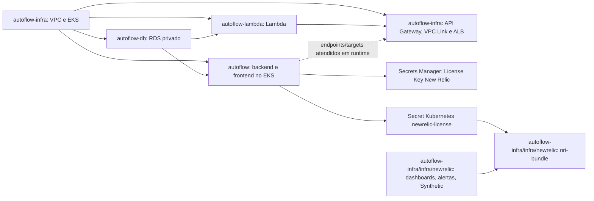

# Reconstrução de homologação após reset do AWS Academy Learner Lab

Este guia consolida o fluxo declarado nos quatro repositórios. Em 26/10/2026, a CLI AWS existe localmente, mas a chamada `sts get-caller-identity` falhou; não há região efetiva configurada no shell. Portanto, IAM, recursos remanescentes, bucket e States atuais **não foram consultados**. Não aplicar sobre State vazio enquanto houver qualquer recurso sobrevivente.

## Disponibilizar os commits e selecionar o workflow

Os cinco commits de checkpoint permanecem nos branches feature locais; nenhum branch foi enviado. Para disponibilizar o trabalho, enviar cada branch ao remoto e abrir PR para `develop`, sem commit direto nessa branch. Os PRs podem ser preparados em paralelo, mas devem ser mesclados **um por vez e nesta ordem**, com secrets, variables e Required reviewers já configurados:

1. **`autoflow-infra`**: mesclar primeiro para disponibilizar VPC/EKS, API Gateway e New Relic. O push pode disparar os três workflows. Só aprovar Apply de VPC/EKS depois do preflight e do Plan; não aprovar Apply de API Gateway nesta etapa (Lambda ainda não foi validada) nem aplicar New Relic (aplicação ainda não está pronta). Se um run consumidor ficar aguardando aprovação ou usar Plan anterior às dependências, rejeitá-lo/cancelá-lo e gerar um novo dispatch quando a etapa correspondente estiver pronta.
2. **`autoflow-db`**: mesclar somente após VPC/EKS `ACTIVE`, node group `ACTIVE` e State EKS correto. O push dispara RDS Plan/Apply; aprovar somente o Plan atual, sem exclusões/substituições.
3. **`autoflow-lambda`**: mesclar somente após RDS `available`, States EKS/RDS confirmados e role de execução Lambda validada conforme a etapa 3 abaixo. O push dispara Plan/Apply; aprovar somente se identidade, pacote e ações do Plan estiverem corretos.
4. **`autoflow`**: mesclar somente após API Gateway implantado e endpoint disponível. O push pode publicar imagens e iniciar Plan/Apply; aprovar só depois de conferir que State RDS, EKS, endpoint e imagens correspondem ao run.

O merge de `autoflow-infra` também pode disparar Plan automático do New Relic, mas push **não** dispara seu Apply. A etapa New Relic só é executada por dispatch depois da aplicação pronta. Merge em `develop` pode iniciar Apply nos outros workflows e, em vários deles, `ALLOW_DESTRUCTIVE=true` permite que o guard deixe passar ações destrutivas para revisão humana. **Não liberar nenhum Environment antes do pré-requisito da etapa e da inspeção do Plan.** Em dispatch, Plan e Apply pertencem ao mesmo run/artifact; onde não há input `apply`, o Apply aguarda reviewers no mesmo run. Não reaproveitar artifact de outra execução.

## Arquitetura e dependências



Dependências comprovadas pelos roots e seus workflows:

| Root | Dependências obrigatórias | Evidência operacional |
|---|---|---|
| VPC/EKS (`autoflow-infra/infra`) | Nenhuma dependência de Terraform remoto | Provisiona VPC, subnets, cluster e node group. Não instala nem planeja New Relic. |
| RDS (`autoflow-db/infra`) | State EKS, VPC/subnets e cluster | Terraform lê `private_subnet_ids` e `eks_cluster_name` do state EKS. O pipeline exige state EKS e bloqueia exclusões/substituições. |
| Lambda (`autoflow-lambda/infra`) | States EKS e RDS | Terraform lê subnet privada do EKS e SG/endpoint do RDS. Workflow exige ambos os objects de state. |
| Aplicação (`autoflow/infra`) | EKS acessível, state RDS e API Gateway existente | Terraform consulta EKS, lê RDS e descobre o endpoint público do API Gateway; Apply também grava Secrets Kubernetes e sincroniza a License Key New Relic. |
| API Gateway (`autoflow-infra/infra/api-gateway`) | State/cluster/node group EKS e Lambda existente | Terraform lê VPC/subnets do state EKS, consulta EKS/node group e Lambda por data sources. Não lê state RDS e não depende diretamente de executar o workflow RDS. |
| New Relic (`autoflow-infra/infra/newrelic`) | VPC/EKS e aplicação disponíveis | State S3 próprio; descobre cluster, confirma node groups ativos, acesso Kubernetes e Deployments/Services da aplicação prontos; valida Secret quando o agente Kubernetes está habilitado. Inventaria ownership remoto antes de criar. |

O Terraform do API Gateway não declara dependência direta do state RDS nem da aplicação: exige Lambda, EKS e node group ativos e pode criar VPC Link/ALB antes de haver targets saudáveis. A aplicação, por sua vez, precisa descobrir o endpoint do API Gateway. Portanto, para reconstrução limpa, o gateway antecede a aplicação; a validação ponta a ponta ocorre depois de ambas.

## Plano de execução único

### Cenários para New Relic

- **Cenário A — reconstrução após reset:** executar VPC/EKS uma vez pelo workflow `Pipeline`; sincronizar a License Key pelo pipeline da aplicação; só então executar `New Relic Pipeline`. Confirmar state legado sem recursos New Relic e inventário remoto ausente. Não há `state mv`, `state rm` nem importação quando não existem objetos anteriores.
- **Cenário B — objetos/state sobreviventes:** parar diante de qualquer objeto remoto New Relic, endereço no state legado/novo ou inventário incompleto. A pipeline normal falha fechada. Com autorização explícita, executar o [runbook de migração](newrelic-state-migration.md), conferir cada address/ID remoto, fazer backup dos states e validar Plans dos dois roots antes de liberar deploys.

Ambos os workflows New Relic e VPC/EKS usam os Environments `homolog` (`develop`) e `production` (`main`) e exigem Required reviewers efetivos para Apply. New Relic preserva a passphrase de criptografia de Plan existente, checksums e artifact de curta retenção vinculado ao commit. Não iniciar Plans de deploy em branches feature.

Antes da primeira execução: reabrir o Learner Lab, configurar as credenciais temporárias da mesma sessão e `AWS_REGION`/`AWS_EXPECTED_ACCOUNT_ID` nos escopos GitHub usados pelos jobs. Durante o preflight, verificar bucket e keys usando as mesmas credenciais, região e conta esperada. `AWS_TERRAFORM_STATE_BUCKET` deve ser configurado explicitamente: embora o helper consiga derivar um nome, os jobs Terraform recebem a variável do GitHub para inicializar o backend.

- Se `head-bucket` confirma acesso ao bucket e owner esperado, manter o bucket e conferir cada key de State; não solicitar criação.
- Se o bootstrap conclui que o bucket está **comprovadamente ausente** (404/NoSuchBucket, não AccessDenied, 403 ou erro ambíguo), somente então executar `Pipeline` VPC/EKS por `workflow_dispatch` com `approve_state_bucket_creation=true`. Esse gate permite criar/proteger o bucket; não aprova recursos Terraform. Confirmar criptografia, versionamento e bloqueio de acesso público antes de continuar.
- Se uma key de State estiver ausente, comparar com inventário AWS somente leitura. State ausente **e nenhum recurso sobrevivente** permite o primeiro provisionamento após confirmação; State ausente **com recursos sobreviventes** exige reconciliação segura, nunca aplicar como se fosse ambiente vazio. O gate `approve_eks_state_reconciliation=true` só cobre imports declarativos inequívocos de VPC, subnets privadas, route table privada e associações. Outros recursos fora desse escopo (incluindo cluster/node group e SG) bloqueiam e precisam de tratamento próprio antes de Apply. AccessDenied/erro ambíguo bloqueia o fluxo e não deve ser interpretado como ausência.

Todos os repositórios devem apontar para o mesmo `AWS_TERRAFORM_STATE_BUCKET`. As keys consumidoras precisam coincidir: o State VPC/EKS deve ser `eks/terraform.tfstate` (infra `AWS_TF_STATE_KEY_INFRA`; consumidores `AWS_INFRA_STATE_KEY`), o State RDS `rds/terraform.tfstate` (`AWS_TF_STATE_KEY` em `autoflow-db`; consumidores `AWS_RDS_STATE_KEY`), e o State Lambda `lambda/terraform.tfstate` (`AWS_TF_STATE_KEY` em `autoflow-lambda`). O State da aplicação, API Gateway e New Relic usa key própria; as keys API Gateway/New Relic devem ser distintas das demais e a New Relic também deve ser diferente do State legado de infra. Os States de homolog não devem apontar para keys de produção.

Em cada dispatch, conferir conta/região e inventário antes de aceitar um Plan. Definir `allow_destructive=false` e `approve_eks_state_reconciliation=false` inicialmente. Só habilitar reconciliação de State de VPC/EKS se o inventário confirmou recursos correspondentes e o Plan resultante foi inspecionado. O script importa automaticamente apenas VPC, subnets privadas, route table privada e associações com correspondência estrita; subnet pública, IGW, NAT, SG e cluster/node group fora do State podem bloquear. **Não autorizar substituição ou exclusão inesperada.** Cancelar/rejeitar a aprovação e reconciliar o State/recursos antes de gerar um novo Plan.

O root `autoflow-infra/infra/sg.tf` declara o SG da plataforma com egress, sem regras ingress explícitas; o EKS também cria/associa regras e Security Groups gerenciados pela AWS. Não importar, remover nem “corrigir” regras gerenciadas automaticamente para silenciar drift. Se o Plan propuser substituir/deletar o SG, cluster ou regras existentes, não aprovar: conferir IDs/associações e State e tratar a divergência antes do próximo Plan. No Lambda, `AWS_LAMBDA_EXECUTION_ROLE_ARN` é entrada externa obrigatória (não é descoberta automática); validar que a role ainda existe na conta e tem trust/policies de execução Lambda antes de iniciar o pipeline. Roles EKS são descobertas; se a role associada ao cluster ACTIVE já não existir no IAM, só aceitar Plan que preserve o cluster como `no-op`; não aceitar tentativa de atualização ou recriação como recuperação.

| Etapa | Workflow e branch | Pré-requisitos e configurações indispensáveis | Plan, aprovação e Apply | Sucesso e retomada segura |
|---|---|---|---|---|
| **1. VPC/EKS** | `autoflow-infra` → `Pipeline`, `develop` | Secrets: `AWS_ACCESS_KEY_ID`, `AWS_SECRET_ACCESS_KEY`, `AWS_SESSION_TOKEN`, `TERRAFORM_PLAN_ENCRYPTION_PASSPHRASE`. Variables: `AWS_REGION`, `AWS_EXPECTED_ACCOUNT_ID`, `AWS_TERRAFORM_STATE_BUCKET`, `AWS_TF_STATE_KEY_INFRA`, `TERRAFORM_APPLY_APPROVAL_CONFIGURED=true`; Environment `homolog` com Required reviewers reais. Roles de cluster/node e operador são descobertas por STS/IAM; conceder `iam:ListRoles` e leituras necessárias, sem cadastrar ARNs. | Dispatch `Pipeline` com `apply=true`, `allow_destructive=false`; usar `approve_state_bucket_creation=true` só se a ausência do bucket foi confirmada, e `approve_eks_state_reconciliation=true` só após identificar recursos remanescentes inequívocos. Inspecionar Plan e aguardar aprovação do Environment no mesmo run. | EKS `ACTIVE`, node group `ACTIVE`, outputs do Terraform publicados em `eks/terraform.tfstate`. Se o Plan exigir troca do cluster ou apontar role ausente/substituição, não aprovar; o preflight exige no-op do cluster quando a role antiga não existe. Manter State e cluster saudáveis; corrigir/reconciliar antes de novo Plan. |
| **2. RDS** | `autoflow-db` → `RDS Pipeline`, `develop` | Requer etapa 1 e State EKS existente. Secrets AWS temporários, `DATABASE_USERNAME`, `DATABASE_PASSWORD`. Variables `AWS_REGION`, `AWS_EXPECTED_ACCOUNT_ID`, `AWS_TERRAFORM_STATE_BUCKET`, `AWS_TF_STATE_KEY` (RDS), `AWS_INFRA_STATE_KEY` (EKS) e guard/reviewers do `homolog`. | `workflow_dispatch`; o job gera artifact confidencial e Apply aguarda Required reviewers. O guard bloqueia qualquer `delete`/replace; não há override destrutivo. | Instância RDS `available`, State `rds/terraform.tfstate` atualizado e outputs disponíveis. Em falha, conservar banco e snapshot; corrigir apenas credenciais, rede ou configuração e gerar novo Plan. |
| **3. Lambda** | `autoflow-lambda` → `Lambda Pipeline`, `develop` | Requer States EKS e RDS. Antes de mesclar o PR ou iniciar o workflow, validar com a sessão AWS atual que `AWS_LAMBDA_EXECUTION_ROLE_ARN` está configurada, pertence à conta esperada, existe no IAM e tem trust para `lambda.amazonaws.com` e policies exigidas pela configuração da função. Comparar o ARN retornado por IAM com o valor configurado; se divergir, estiver obsoleto ou a consulta retornar AccessDenied, bloquear antes do Plan. Secrets AWS temporários, `DATABASE_USERNAME`, `DATABASE_PASSWORD`, `JWT_SECRET` (mínimo 32 caracteres). Variables `AWS_REGION` (workflow valida `us-east-1`), `AWS_EXPECTED_ACCOUNT_ID`, `AWS_TERRAFORM_STATE_BUCKET`, `AWS_TF_STATE_KEY=lambda/terraform.tfstate`, `AWS_INFRA_STATE_KEY=eks/terraform.tfstate`, `AWS_RDS_STATE_KEY=rds/terraform.tfstate`, `AWS_LAMBDA_EXECUTION_ROLE_ARN`, `TERRAFORM_APPLY_APPROVAL_CONFIGURED`; bucket com Versioning habilitado e prefixo de pacotes preservado. | `workflow_dispatch`; publica pacote versionado no bucket State, gera Plan vinculado ao commit/pacote e bloqueia ações destrutivas/identidade. O preflight IAM externo deve ocorrer antes de mesclar/disparar este pipeline: o workflow valida a presença do ARN, não substitui a conferência de sua atualidade. Apply baixa e verifica o artifact do mesmo run e aguarda reviewers. | Lambda `Active`; State e `VersionId` do pacote correspondem ao Plan. Em falha de pacote/Apply, preservar objeto e State; repetir por novo dispatch/Plan, sem sobrescrever pacote imutável. |
| **4. API Gateway** | `autoflow-infra` → `Migração HTTP API`, `develop` | Requer EKS e node group `ACTIVE`, State EKS, Lambda `autoflow-cpf-validator-homolog`, bucket e States corretos. Secrets AWS temporários. Variables `AWS_REGION`, `AWS_EXPECTED_ACCOUNT_ID`, `AWS_TERRAFORM_STATE_BUCKET`, `AWS_TF_STATE_KEY_INFRA`, `AWS_TF_STATE_KEY_GATEWAY`, `API_GATEWAY_CORS_ORIGINS` (array JSON), `TERRAFORM_APPLY_APPROVAL_CONFIGURED`; Environment `homolog` com reviewers. Para checkout privado do contrato `autoflow`, `AUTOFLOW_READ_TOKEN` só se `github.token` não tiver acesso. | `workflow_dispatch`, `allow_destructive=false`; Plan/artifact da execução e aprovação do Environment. O Apply valida hash e aplica o arquivo de Plan baixado do mesmo run. | HTTP API, VPC Link e ALB existem e outputs incluem endpoint. Targets podem não estar saudáveis até a etapa 5. Se state/import ou nome único de Lambda/EKS/node group falhar, parar e reconciliar; não recriar API/ALB já existentes. |
| **5. Aplicação** | `autoflow` → `Pipeline`, `develop` | Requer EKS acessível, State RDS, API Gateway e Docker Hub. Secrets AWS temporários, `SONAR_TOKEN`, `SNYK_TOKEN`, `TF_PLAN_ENCRYPTION_KEY` (mínimo 32 caracteres), `DOCKERHUB_PASSWORD`, `AUTOFLOW_DB_USERNAME`, `AUTOFLOW_DB_PASSWORD`, `AUTOFLOW_JWT_SECRET`, `AUTOFLOW_MAIL_PASSWORD`, `AUTOFLOW_PUBLIC_TOKEN_SECRET`; `NEW_RELIC_LICENSE_KEY` em `homolog`. Variables `AWS_REGION`, `AWS_EXPECTED_ACCOUNT_ID`, `AWS_TERRAFORM_STATE_BUCKET`, `AWS_TF_STATE_KEY`, `AWS_RDS_STATE_KEY`, `DOCKERHUB_USERNAME`, `API_GATEWAY_CORS_ORIGINS`, `ENABLE_NEWRELIC_APM=true`, `NEW_RELIC_LICENSE_SECRET_ID`, `TERRAFORM_APPLY_APPROVAL_CONFIGURED`; reviewers reais em `homolog`. | `workflow_dispatch` sem `smoke_tests_only`, `allow_destructive=false`. Publica imagens antes do Plan; Apply só após Plan revisado e approval do Environment. Usa artifact criptografado, vinculado a commit/configuração/hashes, e aplica exatamente o Plan descriptografado. | Deployments backend/frontend com rollout concluído; Secrets Kubernetes válidos; com APM habilitado, License Key sincronizada ao Secrets Manager/Kubernetes. Se falhar depois de publicar imagens, imagens podem permanecer sem deploy; retomar com novo Plan, sem alterar imagens/recursos saudáveis manualmente. |
| **6. New Relic** | `autoflow-infra` → `New Relic Pipeline`, `develop` | Requer etapa 5 concluída, EKS/node group ativos, workloads prontos e Secret Kubernetes se integração habilitada. Secrets AWS temporários, `TERRAFORM_PLAN_ENCRYPTION_PASSPHRASE`, `NEW_RELIC_API_KEY`. Variables `AWS_REGION`, `AWS_EXPECTED_ACCOUNT_ID`, `AWS_TERRAFORM_STATE_BUCKET`, `AWS_TF_STATE_KEY_INFRA`, `AWS_TF_STATE_KEY_NEWRELIC` (Environment homolog), `NEW_RELIC_REGION`; `NEW_RELIC_ACCOUNT_ID` se recursos de conta ativos; flags `ENABLE_NEWRELIC_KUBERNETES`/`ENABLE_NEWRELIC_ACCOUNT_RESOURCES` conforme escopo; guard e reviewers reais. | `workflow_dispatch` com `apply=true`, `allow_destructive=false`. Plan confirma State legado/novo, inventário remoto e Helm; artifact criptografado inclui commit, hash e fingerprint. Aplicação aguarda reviewers e revalida fingerprint/state/inventário; usa exatamente o Plan do run. | Release Helm pronta e/ou recursos de conta correspondentes aos flags; State New Relic sem overlap com State legado. Se ownership remoto/state existir ou inventário estiver inconclusivo, parar e seguir `newrelic-state-migration.md` com autorização; nunca limpar State para forçar Plan. |
| **7. Validação ponta a ponta** | `autoflow` → `Pipeline`, `develop` (smoke após deploy) | Etapas anteriores concluídas; `AWS_REGION`, `AWS_EXPECTED_ACCOUNT_ID`, CORS e credenciais AWS acessíveis ao job. Secrets sintéticos `AUTOFLOW_TEST_CPF_CNPJ` e `AUTOFLOW_TEST_PASSWORD` somente se executar smoke autenticado. | Após Apply aprovado, `smoke-tests` executa no workflow; alternativamente dispatch com `smoke_tests_only=true` só executa smoke e não aplica. | Smoke HTTP, CORS, login/rota autenticada e targets saudáveis; EKS/node group `ACTIVE`, RDS `available`, Lambda `Active`. Em falha, identificar componente e retomar pelo primeiro pré-requisito faltante. |

### Comandos para iniciar e inspeção AWS somente leitura

Depois de disponibilizar os commits em `develop`, o primeiro dispatch é VPC/EKS. O comando abaixo inicia o mesmo `Pipeline` do botão **Run workflow**; mantenha os gates de bootstrap/reconciliação falsos até confirmar inventário. Execute a partir de qualquer diretório com `gh` autenticado:

```bash
gh workflow run pipeline.yml --repo autoflow-fiap/autoflow-infra --ref develop \
  -f apply=true \
  -f approve_state_bucket_creation=false \
  -f approve_eks_state_reconciliation=false \
  -f allow_destructive=false
```

Antes desse dispatch, fazer o preflight do bucket. Use a consulta abaixo com a sessão e conta esperadas; se houver resposta ambígua/AccessDenied, parar. Se o bucket estiver ausente de forma conclusiva, repetir o dispatch acima mudando somente `approve_state_bucket_creation=true`:

```bash
aws s3api head-bucket --bucket "$AWS_TERRAFORM_STATE_BUCKET" \
  --expected-bucket-owner "$AWS_EXPECTED_ACCOUNT_ID" --region "$AWS_REGION"
```

Para os passos seguintes: `gh workflow run pipeline.yml --repo BrunoSousa06/autoflow-db --ref develop`; `gh workflow run pipeline.yml --repo BrunoSousa06/autoflow-lambda --ref develop`; `gh workflow run api-gateway.yml --repo autoflow-fiap/autoflow-infra --ref develop -f allow_destructive=false`; `gh workflow run pipeline.yml --repo BrunoSousa06/autoflow --ref develop -f allow_destructive=false`; `gh workflow run newrelic.yml --repo autoflow-fiap/autoflow-infra --ref develop -f apply=true -f allow_destructive=false`. Os nomes de workflow/inputs acima foram conferidos nos YAMLs locais. Para cada execução, aguardar o Plan, ler o resumo/artifact do próprio run e liberar o gate somente se não houver exclusão ou substituição inesperada.

Após obter credenciais AWS novas, verificar conta, região, roles, recursos e existência das keys **sem executar Plan/Apply**. Exemplo Bash (valores vêm de configuração local segura; não imprimir credenciais nem conteúdo de State):

```bash
python scripts/verify_aws_account.py
aws ec2 describe-availability-zones --region "$AWS_REGION" --query 'AvailabilityZones[0].RegionName' --output text
aws eks list-clusters --region "$AWS_REGION" --output table
aws iam list-roles --query 'Roles[].[RoleName,Path,RoleId]' --output table
aws ec2 describe-vpcs --region "$AWS_REGION" --filters Name=tag:Name,Values=main-vpc --query 'Vpcs[].[VpcId,OwnerId,CidrBlock]' --output table
aws rds describe-db-instances --region "$AWS_REGION" --query 'DBInstances[].[DBInstanceIdentifier,DBInstanceStatus]' --output table
aws lambda list-functions --region "$AWS_REGION" --query 'Functions[].[FunctionName,State]' --output table
aws apigatewayv2 get-apis --region "$AWS_REGION" --query 'Items[].[Name,ApiId,ApiEndpoint]' --output table
aws s3api head-bucket --bucket "$AWS_TERRAFORM_STATE_BUCKET"
aws s3api head-object --bucket "$AWS_TERRAFORM_STATE_BUCKET" --key "$AWS_TF_STATE_KEY_INFRA" --query '{LastModified:LastModified,VersionId:VersionId}'
```

Antes de mesclar `autoflow-lambda` e antes do seu Plan, verificar o ARN configurado externamente (não o copiar para documentação/logs):

```bash
LAMBDA_ROLE_NAME="${AWS_LAMBDA_EXECUTION_ROLE_ARN##*/}"
test "$(aws iam get-role --role-name "$LAMBDA_ROLE_NAME" --query 'Role.Arn' --output text)" = "$AWS_LAMBDA_EXECUTION_ROLE_ARN"
aws iam get-role --role-name "$LAMBDA_ROLE_NAME" --query 'Role.AssumeRolePolicyDocument.Statement[].Principal.Service' --output json
aws iam list-attached-role-policies --role-name "$LAMBDA_ROLE_NAME" --output table
```

Confirmar que o ARN retornado pertence à conta `sts get-caller-identity`, que a trust policy permite `lambda.amazonaws.com` e que as policies cobrem logs, VPC e as ações declaradas pela função. Qualquer divergência/negação bloqueia a integração do branch e o Plan; atualizar a configuração externa aprovada antes de retomar.

Se EKS listar cluster, consultar `aws eks describe-cluster` e `aws eks list-nodegroups`; consultar cada node group com `describe-nodegroup` e validar a role retornada por `describe-cluster` com `aws iam get-role`. Confirmar do mesmo modo a existência da role Lambda externa. Para cada State key (infra, RDS, Lambda, API Gateway, aplicação e New Relic), `head-object` deve ser interpretado distinguindo 404 conclusivo de AccessDenied/erro de rede. Depois de confirmar bucket/key, `terraform state list` em cada root é somente leitura e compara os endereços registrados; nunca imprimir `terraform state pull`. As consultas não substituem inventário por IDs/associações nem autorizam import.

## Bloqueios atuais antes do primeiro Apply

1. **Os commits ainda não estão no GitHub**: os branches locais estão à frente dos remotos e os workflows de homolog só planejam em `develop`; é necessário publicar branches e passar PR/CI antes de executar CD.
2. **A autenticação local pós-reset não está disponível**: CLI AWS instalada, mas STS falhou e não há região efetiva no shell. Assim, identidade, roles atuais/obsoletas (inclusive `AWS_LAMBDA_EXECUTION_ROLE_ARN`), cluster associado a role ausente, Security Groups sobreviventes e States não foram confirmados. O histórico anterior ao reset informava cluster EKS `ACTIVE` sem node group; não considerar esse estado atual até verificá-lo novamente. Renovar credenciais/configurar região e executar a inspeção somente leitura acima antes do primeiro Plan.
3. **O gatilho de merge para `develop` pode avançar até o Apply**: vários workflows de push habilitam a revisão de ações destrutivas antes de chegar ao gate humano. Não mesclar com secrets/reviewers incompletos, nem aprovar Plan sem conferência manual. A inconsistência real entre State e recursos permanece indeterminada até as consultas AWS; qualquer discrepância que surgir bloqueia aquele root, não deve ser contornada com aprovação.

Não executar dois Applies em paralelo. Os workflows são independentes, portanto iniciar uma etapa somente depois do critério de sucesso da anterior. Em qualquer falha parcial: registrar run/commit/artifact e etapa concluída; conferir State e recurso remoto em modo somente leitura; manter recursos saudáveis; não reutilizar artifact antigo depois de mudança de State/configuração. Fazer novo Plan após corrigir ou reconciliar a causa. Não usar `terraform destroy`, `state rm`, edição manual de State nem autorização destrutiva para contornar erro.

### Diagrama da sequência atual

```mermaid
sequenceDiagram
  actor Operador
  participant I as autoflow-infra: VPC/EKS
  participant D as autoflow-db: RDS
  participant L as autoflow-lambda: Lambda
  participant A as autoflow: aplicação + License Key
   participant N as autoflow-infra/infra/newrelic: New Relic
  participant G as autoflow-infra: API Gateway
   Operador->>I: Dispatch Plan/Apply VPC/EKS + aprovação
   I-->>Operador: EKS/node group disponível
  Operador->>D: Dispatch; Plan + aprovação/Apply
  Operador->>L: Dispatch; Plan + aprovação/Apply
   Operador->>G: Dispatch do workflow API Gateway; Plan + aprovação/Apply
   Operador->>A: Dispatch; build/publicação + Plan + aprovação/Apply
   A-->>A: Sincroniza License Key em Secrets Manager e Kubernetes
   Operador->>N: Dispatch independente New Relic; Plan + aprovação/Apply
  Operador->>A: Smoke tests (dispatch opcional ou pós-deploy)
```

## GitHub: configuração necessária

Configurar os dados abaixo em cada repositório/Environment conforme os catálogos locais `docs/variables-and-secrets.md` dos quatro repositórios. Os nomes são referências, não valores a copiar. `homolog` e `production` devem permanecer isolados; a reconstrução deste guia usa apenas `develop`/`homolog`.

| Repositório | Secrets relevantes | Variables relevantes |
|---|---|---|
| `autoflow-infra` | Credenciais temporárias AWS `AWS_ACCESS_KEY_ID`, `AWS_SECRET_ACCESS_KEY`, `AWS_SESSION_TOKEN`; `TERRAFORM_PLAN_ENCRYPTION_PASSPHRASE`; `NEW_RELIC_API_KEY` | `AWS_REGION`, `AWS_EXPECTED_ACCOUNT_ID`, `AWS_TERRAFORM_STATE_BUCKET`, keys de State, CORS, flags/inputs New Relic e proteção de aprovação. As roles de cluster/node e a role operador são descobertas após validação STS/IAM; não cadastrar ARNs. Cluster, Lambda e node group são descobertos. |
| `autoflow-db` | Credenciais AWS; `DATABASE_USERNAME`, `DATABASE_PASSWORD` | Região/conta/bucket, keys RDS/EKS e proteção de aprovação. Cluster é lido do output do State EKS. |
| `autoflow-lambda` | Credenciais AWS; `DATABASE_USERNAME`, `DATABASE_PASSWORD`, `JWT_SECRET` | Região/conta/bucket, keys EKS/RDS/Lambda, ARN da role de execução e proteção de aprovação. Nome Lambda e bucket de pacote não são configurados à parte. |
| `autoflow` | Credenciais AWS; `TF_PLAN_ENCRYPTION_KEY`; `DOCKERHUB_PASSWORD`; secrets de aplicação `AUTOFLOW_*`; `NEW_RELIC_LICENSE_KEY` no Environment homolog | Região/conta/bucket/key aplicação, Docker Hub, CORS, `ENABLE_NEWRELIC_APM`, `NEW_RELIC_LICENSE_SECRET_ID` e proteção de aprovação. Cluster e endpoint API Gateway são descobertos. |

Os pipelines não compartilham automaticamente secrets entre repositórios. Configure-os no escopo onde são consumidos. Credenciais AWS Academy são temporárias e precisam ser renovadas no reinício da sessão. Configure Required reviewers efetivos em cada Environment `homolog`; a variável de guard não substitui a regra do GitHub. `AWS_EXPECTED_ACCOUNT_ID` é configuração externa e deve ser comparada com `sts get-caller-identity` pelos jobs; nenhum ID deve ser embutido em uma proposta de orquestração.

## Plan, Apply, state e segurança

- Para cada root, o workflow faz CI, Plan e publica artifact temporário do plan (os detalhes de criptografia/metadata variam por repositório). Apply consome o artifact daquela execução e verifica hash/commit/configuração antes de aplicar o binário aprovado; nunca gerar plan novo depois da aprovação para aplicar outro conteúdo.
- RDS/Lambda/aplicação/gateway usam `develop` para homolog. `main` não é caminho de reconstrução de homolog e deve permanecer separado como production quando o workflow suporta produção.
- VPC/EKS usa o Environment selecionado pela branch; dispatch em `main` é production. Em `develop`, Apply pode decorrer tanto de push quanto de dispatch com `apply=true`; usar homolog, não production.
- O guard RDS/Lambda bloqueia exclusões/substituições. Guards de VPC/EKS, API Gateway, aplicação e New Relic recebem configuração diferente em push e dispatch; em push para `develop`, alguns permitem ações destrutivas para revisão humana. Usar dispatch com `allow_destructive=false` quando houver essa opção e **rejeitar qualquer resumo do Plan com delete/replace inesperado** antes de aprovar Required reviewers.
- Bootstrap de bucket no pipeline `autoflow-infra` é condicionado pelo input `approve_state_bucket_creation`, cujo default é `false`; somente um `workflow_dispatch` com aprovação explícita pode criar o bucket ausente. Pushes não autorizam a criação. A reconciliação de rede tem gate separado, `approve_eks_state_reconciliation`, também `false` por default. Com esse gate, a pipeline pode preparar imports declarativos apenas para os recursos VPC/subnets privadas/route table/associações com correspondência inequívoca. A reconciliação de Access Entry/Policy EKS usa o mesmo gate. A aplicação do Plan continua no Environment protegido por Required reviewers; importar não autoriza Apply. Divergências não suportadas ou ambíguas interrompem o fluxo para reconciliação específica, sem exclusão ou substituição automática. Preservar criptografia, versionamento e bloqueio de acesso público no bucket.
- A License Key da aplicação e a New Relic User API key são segredos distintos. A License Key de runtime fica no Environment `homolog` do repositório `autoflow`, e é reconciliada com Secrets Manager/Kubernetes; a User API key no `autoflow-infra` permite inventário remoto e provider de recursos de conta.

## Validação

Antes de plan/apply, confirmar sessão, conta e região:

```bash
aws sts get-caller-identity
python scripts/verify_aws_account.py
```

Validações locais sem backend para cada checkout (não aplicam recursos):

```bash
terraform -chdir=infra fmt -check -recursive
terraform -chdir=infra init -backend=false -input=false
terraform -chdir=infra validate
```

Para o gateway, executar também `terraform -chdir=infra/api-gateway test`. Após provisionamento, validar status EKS/node group `ACTIVE`, RDS `available`, Lambda `Active`, endpoints e targets do gateway, rollout da aplicação e os smoke tests `python scripts/smoke_api_gateway.py` com os argumentos/configuração homolog apropriados. Nunca colocar tokens ou credenciais de teste em logs.

## Falhas e recuperação

| Sintoma | Ação segura |
|---|---|
| Credencial expirada, conta/região diferente ou AccessDenied | Parar; reabrir Learner Lab, renovar a sessão, conferir identidade/escopo de permissão e repetir preflight. Não reinterpretar negação como recurso ausente. |
| Bucket ou state ausente | Verificar bucket/key e inventário. Bootstrap somente pela opção autorizada do workflow. Para state ausente com recurso existente, interromper e planejar import/adopção com revisão própria; não aplicar root sobre state vazio. |
| Plan destrutivo/inesperado | Não aprovar. Conferir state, inventário e recurso remoto; recuperar state ou corrigir inputs e gerar novo Plan/artifact. |
| Falha parcial após Apply | Registrar etapa e outputs, verificar recursos e state de cada root, manter os roots já concluídos. Retomar a partir do primeiro pré-requisito ainda ausente com novo Plan; não reaplicar artifact antigo contra state alterado. |
| EKS pronto, mas New Relic falha | Confirmar `ENABLE_NEWRELIC_APM`, configuração externa, identidade/região, ausência de conflito de state e Secret Kubernetes. Aplicação deve sincronizar primeiro; então regenerar Plan de `New Relic Pipeline`. |
| RDS inacessível à aplicação/Lambda | Conferir SGs, endpoint e states EKS/RDS; não recriar banco como tentativa. Snapshots/dados não são revertidos por rollback Terraform. |
| Gateway criado sem targets saudáveis | Verificar rollout e Services/NodePorts da aplicação, ALB/Target Groups e VPC Link. Corrigir declarativamente e gerar plan quando recursos Terraform mudarem. |

Não executar `terraform destroy`, editar state manualmente, trocar de conta para prosseguir ou remover recursos compartilhados. Rollback é uma mudança declarativa nova, com novo Plan e aprovação.

## Intervenções manuais que permanecem

No fluxo atual, uma pessoa precisa reativar/renovar Learner Lab e secrets AWS, iniciar cada workflow necessário, inspecionar Plans, aprovar cada Apply no Environment e executar validação/smoke. O cenário A usa states vazios somente após confirmar ausência remota, sem migração. O cenário B exige autorização e segue o [runbook de migração](newrelic-state-migration.md), separado do deploy normal. A orquestração central permanece trabalho separado: a análise/prova mínima `autoflow-infra` → `autoflow-lambda` está no [plano de implementação](specs/reconstrucao-learner-lab/plano-implementacao.md), e não chama pipelines de deploy.

## Fontes locais

`.github/workflows/pipeline.yml` e `api-gateway.yml`, `infra/*.tf`, `docs/eks-primeiro-provisionamento.md`, `docs/variables-and-secrets.md` neste repositório; e os workflows, Terraform e `docs/variables-and-secrets.md` de `autoflow-db`, `autoflow-lambda` e `autoflow`. As configurações efetivas dos Environments e a disponibilidade atual da AWS não foram verificadas nesta análise.
